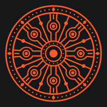

# Magnite — Studio Motion

The user-requested refinement on `design/intuitive-motion` builds on master's
Studio 03 palette and native workspace navigation. The final polish pass covers
Library, Training, Knowledge, Adapters, Playground and Settings.

## Identity and motion

The original vector mark is inspired by the Konark Sun Temple wheel: eight
sculpted principal spokes, eight alternating slender spokes, a beaded rim and
concentric hub. Reference: [Konark wheel photograph](https://commons.wikimedia.org/wiki/File:Konark_ei2-15.jpg)
and [UNESCO's temple description](https://whc.unesco.org/en/list/246).
No photograph or traced asset is shipped. `BrandMark` draws the geometry natively
with theme colors and simplifies it at small icon sizes.

[Vector export](brand/konark-wheel.svg). The same geometry appears in the app icon,
sidebar, training session and conversation welcome.

Training and chat animate the wheel while work is active. Completion, cancellation
and errors restore the idle state. Native buttons respond to mouse and keyboard
activation with a short ripple. Reduced motion freezes the wheel, removes ripples,
skips transitions and suppresses the response cursor blink. Hidden or inactive
animations stop their timers; the sidebar and idle training mark stay static.

## Interaction polish

- Consistent typography, control targets, theme contrast, focus and disabled states.
- Compact layouts with a pinned chat composer, wrapping metadata and a scrollable
  training inspector; expanded hyperparameters fit without horizontal scrolling.
- Keyboard-selectable model/document cards and clear destructive confirmations.
- Training submission, cancellation and retry states; chat stream/load safeguards
  and scroll position preservation while reading previous messages.
- Clear download/query/ingestion failures and retry recovery. Adapter exports use
  a Save dialog and atomic file writes that preserve an existing file on failure.
- Local-only runtime settings, immediate appearance preferences and explicit save
  feedback. Unsupported hosted controls and nonfunctional options are removed.

Colors remain in `app/src/theme.h`; the token-based QSS preserves both themes.
Backend route contracts and ML engines are unchanged.

## Review and verification

Build with `cmake -S app -B build` and `cmake --build build -j4`, then launch
`./build/magnite-app`.

- [Dark training](previews/dark/panel-1.png), [light Settings](previews/light/panel-5.png),
  [compact Playground](previews/compact/panel-4.png).
- [Running training](previews/states/training-running.png),
  [expanded compact setup](previews/states/training-expanded-compact.png),
  [conversation](previews/states/chat-conversation.png).

Full-app captures show empty disposable workspaces at 1280×820 and 1024×680.
The header can show Connecting because capture starts before backend readiness.
Populated `states/` captures use synthetic fixture data, not model outputs.

The build, theme audit, UI checks at normal and 2× scale, 24 backend regressions,
bare desktop selftest and all five real-model feature selftests passed.
See [dated evidence and limitations](../../docs/release/UI_POLISH.md).
`--ui-check [capture-dir]` now provides repeatable interaction/layout checks in CI.
