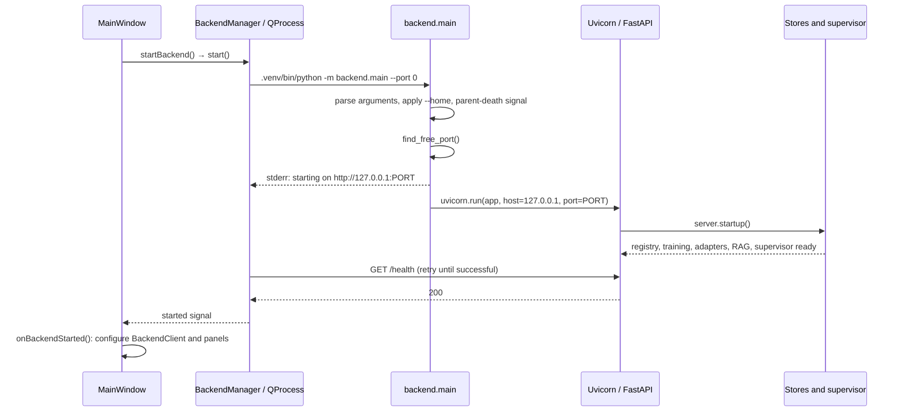

# Backend process and call map

This document describes the code in `backend/src/backend` and its desktop callers.
For request bodies and examples, see [LOCAL_API.md](../LOCAL_API.md). For the audit,
verified behavior, and unresolved issues, see [BACKEND_AUDIT.md](BACKEND_AUDIT.md).

## 1. Desktop startup through readiness



1. `app/src/mainwindow.cpp`: `startBackend()` calls `BackendManager::start()`.
2. `app/src/backend_manager.cpp`: `launchBackend()` finds the repository relative
   to `<repo>/build/magnite-app`, prepends `<repo>/backend/src` to `PYTHONPATH`,
   chooses `.venv/bin/python` (Windows: `.venv/Scripts/python.exe`), and falls
   back to `python3`. Working directory is the binary directory.
3. The child inherits the desktop environment. Saved `storage/dataDir` becomes
   `MAGNITE_HOME` only if the latter was not already set. The saved engine
   preference becomes `MAGNITE_ENGINE_OVERRIDE` (0–2).
4. `backend/main.py` imports `server.app`, then `main()` parses `--port` and
   `--home`. `--home` updates `MAGNITE_HOME` before startup initializes stores.
   Linux uses `prctl(PR_SET_PDEATHSIG, SIGTERM)` on a best-effort basis.
5. Port 0 means bind a temporary socket to obtain a free port, close it, print
   the startup address on stderr, and start Uvicorn on that port. There is a
   small bind race between those two socket operations; the printed line is
   not itself a readiness guarantee.
6. `server.startup()` performs the setup sequence below. Uvicorn serves requests
   after startup completes. `BackendManager` parses complete stderr lines and
   retries `/health`; success emits `started`.
7. `MainWindow::onBackendStarted()` assigns the URL to `BackendClient` and gives
   that client to Models, Training, Knowledge/RAG, Adapters, and Chat panels.
   The local model refresh discovers cached models at this point.

Standalone entry point: the `magnite-backend` script from `pyproject.toml` also
calls `backend.main:main`. `python -m backend.main` uses the same path. Running
Uvicorn directly on `backend.server:app` bypasses CLI argument and parent-death
setup, although FastAPI startup still executes.

## 2. Startup objects and ownership

| Startup call, in order | Objects created / responsibility |
| --- | --- |
| `routes.models._registry_setup()` | `ModelStore(models.db)` → `ModelRegistry`, Hub API client, pull-job dictionary |
| `routes.training._training_setup()` | An `AdapterStore`, `DatasetStore`, `TrainingJobManager`; loads durable jobs and starts one daemon training queue thread |
| `routes.adapters._adapter_setup()` | A second `AdapterStore` instance pointing to the same `adapters.db`, for adapter routes and inference |
| `routes.rag._rag_setup()` | `RagStore(rag/)`, assigned to the RAG module singleton |
| `get_supervisor().set_adapter_store(store)` | Lazily creates the single `InferenceSupervisor`, probes hardware/engine packages, assigns adapter store |

Stores are module-level singletons, not per-request instances. The supervisor is
also a module singleton and survives repeated app lifespans in the same Python
process. Normal desktop restarts create a fresh process.

Importing `server` does not load model weights. Engine availability probes during
startup can import installed ML packages; missing extras are handled by the
engine checks. Loading weights happens only on inference/adapter requests,
training jobs, or the first embedding request. A successful `/health` means the
HTTP service is ready, not that any model, GPU, or embedding model is loaded.

## 3. IPC and scheduling

`app/src/backend_client.cpp` uses Qt Network for GET/POST/DELETE requests and SSE.
Ordinary requests and streaming requests have a 600-second transfer timeout.
Closing a stream aborts the Qt reply. FastAPI/Pydantic validate request bodies;
synchronous route handlers run in the framework's worker pool. Async handlers
must explicitly move blocking operations off the event loop.

| Work | Execution / coordination |
| --- | --- |
| SQLite stores | Short synchronous calls, connection per operation; instance locks; SQLite transactions |
| Hub/Ollama model pulls | One daemon thread per pull; in-memory job state, polled by ID |
| Training | One serialized daemon queue thread; durable job history, cooperative cancel event |
| Load model / activate adapter / ingest document | `request_work()` → `asyncio.to_thread`, plus disconnect watcher |
| llama.cpp generation | Native generator in a background thread via `threaded_stream()` |
| torch generation | Threaded stream bridge plus `model.generate()` worker and `TextIteratorStreamer` |
| vLLM | Separate local Python server subprocess, async HTTP/SSE client |
| Ollama | External server owned by the user, async HTTP/NDJSON client |

`InferenceSupervisor.operation()` is a nonblocking lock shared by inference
load/unload, adapter changes, generation, and protected deletion routes. Busy
operations fail rather than queue. Training does **not** acquire that lock, so
training and inference can compete for GPU/RAM.

`request_work()` watches disconnects, sets a threading cancellation event, and
waits for the worker to finish before releasing ownership. Native calls cannot
be forcibly interrupted. Cancelled loads unload their result; cancelled document
ingestion checks before publishing its record.

## 4. Model library, discovery, pulls, and deletion

```text
GET /models[?source=huggingface&q=...]
  → routes.models.list_models()
  → ModelRegistry.list_synced()
      → _record_hf_models() → huggingface_hub.scan_cache_dir()
          → inspect cached model revisions and local weight files
          → ModelStore.get()/upsert()
      → _record_ollama_models() → GET Ollama /api/tags (unless source excludes it)
      → ModelStore.list(source, q)
  → JSON ModelRecord[] → ModelsPanel cards
```

Discovery is offline and runs on list refresh, not as a startup download.
`GET /models/{id}` also refreshes the list. Records use
`huggingface:owner--repository` or `ollama:name:tag` IDs. A direct inference load
by registry ID requires that the record already exists (normally the preceding
model-list request creates it).

The Hub library's `HF_HUB_CACHE` constant supplies the default location. Set
these variables **before starting the desktop/backend**, because the library
reads them at import time. Precedence is:

1. `HF_HUB_CACHE` — exact Hub cache directory.
2. `HUGGINGFACE_HUB_CACHE` — legacy exact cache directory.
3. `HF_HOME` plus `/hub`.
4. `XDG_CACHE_HOME` plus `/huggingface/hub`.
5. `~/.cache/huggingface/hub`.

`MAGNITE_HOME` controls application databases, not Hub weights. An explicit
`ModelRegistry(..., hf_cache=...)` is available to tests and embedded callers.
The previous implementation incorrectly passed `HF_HOME` directly to downloads.
If old downloads really live directly in that directory, `HF_HUB_CACHE` can point
there explicitly; no files are automatically moved by this fix.

Discovery rules:

- Scan only model repositories, excluding datasets and Spaces.
- Accept a nonempty `.gguf` file, or `config.json` plus a nonempty conventional
  `model.safetensors`/`pytorch_model.bin`, or every shard named by a supported
  weight index. Config/tokenizer-only and adapter-only snapshots are skipped.
- Keep an existing usable registered revision. Otherwise prefer usable `main`,
  then newest modification time, with commit hash as a stable tie breaker.
- Store one record per repository, preserving existing display name, license,
  metadata, and download timestamp. Record the selected hash in `meta.cache_revision`.
- Broken repositories produce warnings; healthy repositories still appear.
  An unavailable cache does not erase existing registry entries.
- This checks file presence, not weight integrity, tokenizer completeness,
  engine compatibility, or available memory. Embedding models can appear in the
  library even though chat uses causal language model loaders. Split GGUF and
  multi-quantization repositories need additional selection support.

`POST /models/pull` creates a `PullJob`, starts a daemon thread, and returns 202.
For HF: `snapshot_download()` → inspect → `HfApi.model_info()` → SQLite upsert →
job done. Ollama uses streaming `/api/pull`, then refreshes `/api/tags`.
`GET /models/pull/{id}` polls process-local progress. Pull history is lost on
restart; there is no pull cancellation endpoint.

`DELETE /models/{id}` checks current inference/training references. HF deletion
uses `scan_cache_dir().delete_revisions(...).execute()` before removing the row;
Ollama deletion calls its `/api/delete`. **This deletes the selected cached
revision, including models discovered from other applications. It is not merely
an “unregister” operation.** Shared blobs needed by other revisions remain.
Another cached revision may be discovered on the next refresh. Tests never
perform this operation on the user's real cache.

## 5. Inference and streaming

```text
POST /inference/load
  → request_work() → supervisor.load_model() [operation lock]
  → _resolve_engine(requested engine, model reference)
  → unload previous engine → make_engine() → engine.load()
  → publish active engine and resolved model path

POST /inference/chat or /inference/completion
  → supervisor._stream() [operation lock held for entire stream]
  → prepare prompt / check context / optionally retrieve RAG passages
  → engine.chat_stream() or complete_stream()
  → routes.inference._response()
      → obtain first token before sending successful HTTP headers
      → SSE deltas + done/error, or collect ordinary JSON response
```

Registered HF IDs resolve to the cached directory when present; otherwise they
fall back to a repository reference. Registered Ollama IDs force Ollama. For a
local directory with Auto and no global override, GGUF selects llama.cpp;
otherwise vLLM is chosen when detected with GPU support, or torch. Explicit
engine arguments take precedence for HF models. Bare repo references follow the
supervisor preference logic, so they are not equivalent to cached directory
references. Engine override 0/1/2 means Auto/vLLM/llama.cpp.

| Engine module | Load / generate / unload behavior |
| --- | --- |
| `engines/llamacpp.py` | Finds local GGUF or fetches one from Hub; local directories choose the smallest GGUF; constructs `llama_cpp.Llama`; native streamed chat/completion; clears model reference on unload |
| `engines/torch.py` | `AutoTokenizer` + `AutoModelForCausalLM`; optional `PeftModel`; CUDA/MPS/CPU device choice; chat-template fallback; generation stopping criteria; clears model/tokenizer and CUDA cache |
| `engines/vllm.py` | Launches `sys.executable -m vllm.entrypoints.openai.api_server`; logs stderr to `vllm.log`; waits up to 240 seconds; forwards streaming calls; terminate/wait/kill on unload |
| `engines/ollama.py` | `/api/show` validates the model; `/api/chat` or `/api/generate` streams tokens; unload requests `keep_alive:0` |
| `engines/base.py` | Shared contract and fallback byte-count context estimate; default context size 2048 |
| `engines/streaming.py` | Worker-to-async queue bridge; propagates exceptions and joins worker on close/cancellation |

Custom SSE payloads are `{"delta":"..."}`, `{"done":true}`, or
`{"error":"..."}`. They are not OpenAI's SSE schema. First-token failures can
return an ordinary HTTP error; failures after headers use an error frame.
`InferenceStreamResponse` also closes workers when ASGI sending fails.

Chat/completion `model` fields do not switch the loaded model. Chat context is
checked against requested output size. RAG prepends a retrieved system message,
truncated to fit. llama.cpp and torch have tokenizer-backed counts; remote
engines inherit the approximate byte-based counts and default context size.

## 6. Datasets and training

```text
POST /datasets/ingest
  → DatasetStore.ingest_path() or ingest_content()
  → normalize JSONL / CSV / paragraphs
  → datasets/<id>.jsonl + datasets.db record

POST /training/start
  → TrainingJobManager.start() → validate dataset/config
  → persist queued TrainingJob → enqueue (job, config, dataset path, cancel event)
  → training-queue thread → run_training()
      → _require_ml() → _resolve_base()
      → load tokenizer and causal LM; optional 4/8-bit settings
      → choose LoRA targets → get_peft_model()
      → tokenize dataset → TrainingArguments / Trainer / progress callback
      → train → save adapter + tokenizer → AdapterStore.upsert()
  → persist terminal job state
```

JSONL supports text, messages, instruction/input/output, and prompt/completion
forms; malformed JSONL rows are rejected. CSV and plain-text normalization have
more permissive fallbacks. Source files remain untouched; normalized copies
belong to Magnite. Training records original config plus metrics and history.
Warmup ratio becomes `warmup_steps`; unsupported target module names may fall
back to architecture mappings or `all-linear`.

Adapter files now go to `adapters/adapter-<job-id>/`. The supplied name remains
display metadata, so repeated names cannot overwrite another job's output and
path-like names cannot escape the adapter directory.

`POST /training/cancel/{id}` sets a cooperative event. Queued jobs can be marked
cancelled immediately; running work checks at preparation and training-step
boundaries. Native loading/training may take time to return. Startup converts
persisted queued/running jobs into interrupted errors, not resumable jobs.
Terminal job records survive restart; intermediate progress is primarily in
memory. `_resolve_base()` decodes HF registry IDs back to repo names rather than
consulting the selected registry revision (a remaining limitation).

## 7. Adapters

`GET /adapters` reads `adapters.db`. Training and imported archives register the
same `AdapterRecord` schema.

- Export: `POST /adapters/export/{id}` writes a ZIP containing `record.json` and
  `weights/*` under `adapters/exports/`; returned GET path streams that ZIP.
- Import: `POST /adapters/import` accepts a server-local ZIP path, serializes
  duplicate checks, validates metadata/config/weight presence and archive paths,
  enforces size/count limits, extracts to a fresh `adapters/imports/adapter-*`
  directory, and registers the rewritten local path. Failure cleans extraction.
- Activate: `POST /inference/adapter` → `request_work()` → supervisor operation
  lock → lookup/validate adapter → unload old engine → load torch + PEFT on the
  resolved base. Empty ID unloads the adapter engine; it does not reload the
  previously selected plain model.
- Delete: acquire inference lock, unload if active, ensure the path is under the
  managed adapter directory, remove weights, then remove the record. Separately
  exported ZIPs remain.

Activation is a restart/load operation, not a native in-place multi-LoRA switch.

## 8. RAG

```text
POST /rag/documents
  → request_work() → _ingest_document()
  → extract local file text or use supplied content
  → chunk_text() [overlapping whitespace-delimited words]
  → embeddings.embed_texts() → cached SentenceTransformer.encode()
  → RagStore.add_document() [document + float32 vector blobs in one transaction]

POST /rag/query
  → embed query → RagStore.search()
  → load matching vectors → NumPy dot product → sort/filter/top-k

chat with rag.enabled
  → _with_rag_context() → injectable_context()
  → same embed/search path → format source-labelled passages
  → fit retrieved system text into inference engine context
```

Text, Markdown, HTML, and text-extractable PDF files are supported. PDF parsing
uses optional `pypdf`; there is no OCR. Inline `content` currently bypasses the
file extraction/markup stripping path. Embeddings are normalized float32 vectors.
There is one cached embedder per backend process and a lock around model changes.

Config updates merge partial values. Changing the embedding model while indexed
documents exist is rejected; ingestion also checks that config/model dimension
has not changed before committing. Retrieval scans the stored vectors in memory;
there is no ANN/vector-server dependency. Deleting a document/clearing the index
removes indexed content and vectors, never the original source file.

## 9. Storage and environment reference

| Relative to `MAGNITE_HOME` | Contents |
| --- | --- |
| `models.db` | Local model records, paths and metadata |
| `datasets.db`, `datasets/<id>.jsonl` | Dataset records and normalized training examples |
| `training_jobs.db` | Serialized jobs/config/status/history |
| `adapters.db`, `adapters/adapter-<job-id>/` | Adapter records and newly trained weights |
| `adapters/imports/`, `adapters/exports/` | Imported weights and generated ZIP archives |
| `rag/rag.db` | RAG configuration, documents, chunks and vector blobs |
| `vllm.log` | vLLM subprocess stderr, appended when used |

Default application home is `~/.magnite`; Windows has an APPDATA branch in
`paths.app_home()`. There are no schema migration versions. Model weights and
embedding caches are separate Hub storage. Qt settings and in-memory desktop
chat history are outside backend ownership.

Other environment inputs: `MAGNITE_ENGINE_OVERRIDE`, `MAGNITE_OLLAMA_URL`
(default `http://127.0.0.1:11434`), Hub authentication/offline/cache variables,
and ML library device/runtime variables. `MAGNITE_OLLAMA_URL` and Hub constants
are read at import; restart after changing them. The service has local-path
operations and no application authentication; it binds loopback in the CLI path.

## 10. Shutdown and troubleshooting entry points

Desktop teardown aborts pending replies and asks `BackendManager::stop()` to
terminate the child. It waits 15 seconds, then kills it and waits another 3.
Uvicorn's FastAPI shutdown runs `TrainingJobManager.shutdown()` in a worker
thread (sets events, persists status, joins its worker for up to 2 seconds),
then runs `InferenceSupervisor.unload()` in a worker thread. vLLM teardown is
part of engine unload. A process-exit handler also attempts vLLM cleanup.

Pull threads are daemon threads with no explicit shutdown join. A busy inference
operation can reject unload; an unresponsive native call can outlast the desktop
shutdown deadline. Forced termination does not guarantee complete cleanup of a
vLLM descendant. These are remaining lifecycle limits, not tested guarantees.

When tracing a problem, start with the desktop stderr, then the route function,
then the service/store/engine named above. `/docs` and `/openapi.json` show the
running API contract. `GET /inference/status` shows the selected active engine;
`/training/status/{id}` and `/models/pull/{id}` distinguish worker errors from
transport failures. Use a disposable `MAGNITE_HOME` for diagnostics that mutate
state; it does not isolate or protect the shared Hugging Face cache from deletion.
