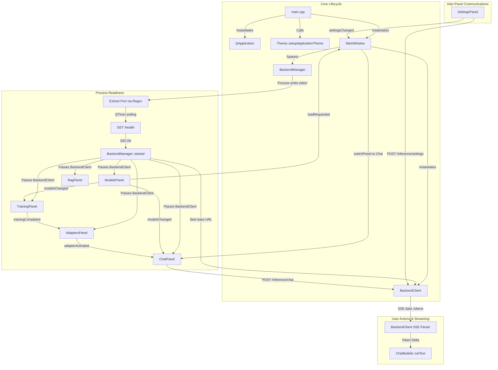

# Magnite LLM — Comprehensive Frontend Architecture & Qt Analysis

This document provides an exhaustive, code-level analysis of the native desktop frontend for Magnite LLM. The frontend is implemented in C++20 and Qt 6. It resides in the `app/` directory and is built as a single desktop executable: `build/magnite-app`.

---

## 1. Architectural Philosophy & System Boundaries

### 1.1 Separation of Concerns
Magnite enforces a strict division of responsibility:
- **Presentation, Interaction, and Orchestration (C++20 / Qt 6)**: The desktop shell owns windowing, state presentation, user input, navigation, hardware preference dispatch, process supervision, and asynchronous REST/SSE communication.
- **Machine Learning & Computation (Python / FastAPI)**: PyTorch, Hugging Face `transformers`, PEFT (LoRA/QLoRA), bitsandbytes, vector embeddings, document chunking, and inference engines (`llama.cpp`, `torch`, `vLLM`, Ollama) run exclusively in the Python backend.
- **The C++ frontend never links against ML libraries** (no libtorch, no CUDA, no onnxruntime in C++). It treats the backend as a black-box service reached over local loopback HTTP.

```text
+-----------------------------------------------------------------------------------+
|                              Desktop Process (magnite-app)                        |
|                                                                                   |
|   +---------------------------------------------------------------------------+   |
|   |                        QApplication (main.cpp)                            |   |
|   |   - Theme::setupApplicationTheme() (Loads bundled OFL fonts, compiles QSS)|   |
|   |   - Command-line flags (--theme-check, --ui-check, --selftest, --screenshot)|  |
|   +-------------------------------------+-------------------------------------+   |
|                                         |                                         |
|                                         v                                         |
|   +---------------------------------------------------------------------------+   |
|   |                           MainWindow (QMainWindow)                        |   |
|   |   - Masthead & Sidebar: Brand seal, wordmark, dark/light switch, nav      |   |
|   |   - Central Starfield background & QGraphicsOpacityEffect crossfades      |   |
|   |   - QStackedWidget hosting 6 distinct workspace panels                    |   |
|   +-----------------+-----------------------------------+---------------------+   |
|                     |                                   |                         |
|                     v                                   v                         |
|     +-------------------------------+   +-------------------------------+         |
|     |  BackendManager (QProcess)    |   |  BackendClient (QNetwork)     |         |
|     |  - Resolves <repo>/build/..   |   |  - Async JSON GET/POST/DELETE |         |
|     |  - Spawns python -m backend   |   |  - Chunked SSE Parser         |         |
|     |  - Parses stderr announcement |   |  - Atomic QSaveFile Downloads |         |
|     |  - Polls /health until ready  |   |  - 600s transfer timeouts     |         |
|     +---------------+---------------+   +---------------+---------------+         |
+---------------------|-----------------------------------|-------------------------+
                      | stdout/stderr                     | Loopback HTTP / SSE
                      v                                   v
+-----------------------------------------------------------------------------------+
|                         Python Backend (127.0.0.1:<random-port>)                   |
|                                                                                   |
|   Uvicorn / FastAPI Application (server.py)                                       |
|     ├── /health, /models, /inference, /training, /rag, /adapters                  |
|     └── Engines: llama.cpp | torch+PEFT | vLLM subprocess | Ollama                |
+-----------------------------------------------------------------------------------+
```

---

## 2. Complete File-by-File Breakdown

### 2.1 Entry Point & Application Lifecycle

#### `src/main.cpp`
- **Responsibility**: Application startup, global Qt application setup, theme registration, CLI verification routing, window instantiation, and event loop execution.
- **Includes**: `<QApplication>`, `<QDir>`, `<QFont>`, `<QSettings>`, `<QTimer>`, `mainwindow.h`, `theme.h`, `testing/uicheck.h`.
- **Key Logic**:
  1. Sets `QCoreApplication` metadata: Organization `Magnite`, Domain `magnite.local`, Application `Magnite LLM`.
  2. Inspects CLI arguments:
     - `--theme-check`: Directly calls `Theme::selfCheck()` (returns 0 on pass) without creating a `QApplication` GUI window.
     - `--ui-check [capture_dir]`: Invokes `runUiCheck(captureDirectory)` to test UI layout and events against an in-process mock HTTP fixture server.
     - `--selftest` or `--ui-check`: Diverts `QSettings` to a unique PID-isolated directory in `QDir::tempPath()` using `QSettings::IniFormat` to avoid clobbering user configuration.
     - `--screenshot <dir>`: Sets up single-shot timers to capture each panel via `MainWindow::captureScreenshots()`.
  3. Initializes application appearance via `Theme::setupApplicationTheme()` and sets the global default font to `Theme::bodyFont()` ("DM Sans").
  4. Instantiates `MainWindow window; window.show();` and runs `app.exec()`.

---

### 2.2 Core Infrastructure & IPC

#### `src/theme.h` & `src/theme.cpp`
- **Responsibility**: Studio 03 Design System single-source-of-truth. Defines design tokens (colors, fonts, radii, spacing), compiles runtime stylesheets (`console.qss`), loads bundled fonts, tints Lucide SVG icons, and enforces WCAG contrast rules.
- **Header Definitions**:
  - Semantic color accessors: `bgVoid()`, `bgDeep()`, `brandOrange()`, `brandInk()`, `brandText()`, `accentPrimary()`, `accentBlue()`, `accentHover()`, `accentActive()`, `accentLabel()`, `accentText()`, `glassFill()`, `glassFillHover()`, `glassFillActive()`, `glassBorder()`, `glassBorderHover()`, `textPrimary()`, `textSecondary()`, `textMuted()`, `statusSuccess()`, `statusWarning()`, `statusError()`.
  - Font accessors: `headingFont()` ("Space Grotesk"), `bodyFont()` ("DM Sans"), `monoFont()` (dynamically discovered fixed-pitch system font).
  - Spacing accessors: `spacingBase()` (6px), `panelPadding()` (16px), `minWindowWidth()` (1024px), `minWindowHeight()` (680px), `cornerRadiusSmall()` (8px).
  - Mode management: `isDark()`, `setDark(bool dark)`.
- **Implementation Mechanics**:
  - **Dynamic QSS Compilation (`Theme::qss()`)**: Loads `:/theme/theme.qss` from Qt resources. Scans and replaces all `@token` tokens with active hex/font values. Sorts tokens by length descending (e.g. `@glassFillHover` before `@glassFill`) to prevent substring collisions.
  - **Dynamic Theme Switching (`Theme::setDark()`)**: Updates internal boolean, constructs a customized `QPalette` with tokens, installs it on `qApp->setPalette()`, re-compiles and sets `qApp->setStyleSheet(qss())`, iterates all existing widgets in `QApplication::allWidgets()` to re-tint custom `themeIcon` dynamic properties, and forces widget updates.
  - **Icon Color Tinting (`Theme::coloredIcon()`)**: Loads bundled Lucide SVG from `:/icons/<name>.svg`. Replaces `stroke="currentColor"` with the target hex string. Renders the SVG into a `QPixmap` scaled by `qApp->devicePixelRatio()` for HiDPI crispness, and wraps it in a `QIcon`.
  - **Font Registration (`Theme::loadFonts()`)**: Uses `QFontDatabase::addApplicationFont()` to register bundled TrueType fonts from resources (`SpaceGrotesk-Regular.ttf`, `SpaceGrotesk-Medium.ttf`, `SpaceGrotesk-SemiBold.ttf`, `DMSans-Regular.ttf`, `DMSans-Medium.ttf`).
  - **Audit & Self-Check (`Theme::selfCheck()`)**: Headless verification engine checking:
    1. Exact token hex values and valid QColor constructs.
    2. Zero un-substituted `@` tokens in compiled QSS.
    3. Absence of malformed CSS color literals.
    4. Existence of all embedded fonts and 17 core Lucide icons in `.qrc`.
    5. Font families registered in `QFontDatabase`.
    6. Non-null output from `coloredIcon()`.
    7. WCAG relative luminance contrast ratio $\ge 4.5:1$ for all text-to-surface pairings across both Light and Dark modes.

#### `src/backend_manager.h` & `src/backend_manager.cpp`
- **Responsibility**: Supervise the external Python backend subprocess, discover its dynamic loopback port, verify health, and ensure graceful termination.
- **Class**: `BackendManager : public QObject`
- **Qt Components**: `QProcess`, `QNetworkAccessManager`, `QNetworkReply`, `QTimer`, `QRegularExpression`, `QSettings`.
- **Execution Flow**:
  1. `start()`: Derives the repository root from `QCoreApplication::applicationDirPath() + "/../"`.
  2. Resolves Python executable: Checks `<repo>/.venv/bin/python` (`.venv/Scripts/python.exe` on Windows); falls back to system `python3`.
  3. Prepares environment (`QProcessEnvironment`):
     - Sets `PYTHONPATH` with `<repo>/backend/src` prepended.
     - Reads `storage/dataDir` from `QSettings`; sets `MAGNITE_HOME` if not already in environment.
     - Reads `engine/override` from `QSettings`; sets `MAGNITE_ENGINE_OVERRIDE`.
  4. Launches `python -m backend.main --port 0` as a child `QProcess`.
  5. **Discovery Protocol**: Connects `QProcess::readyReadStandardError` to `onProcessReadyRead()`. Buffers incoming stderr chunks into `m_stderrBuffer` across line boundaries. When Python outputs `Magnite backend starting on http://127.0.0.1:<port>`, extracts port via regex `http://127\.0\.0\.1:(\d+)`.
  6. **Health Verification**: Initiates single-shot `QTimer` polling `GET http://127.0.0.1:<port>/health` via `QNetworkAccessManager`. Upon `QNetworkReply::NoError`, sets `m_started = true` and emits `started()`.
  7. **Graceful Shutdown**: In `stop()` and `~BackendManager()`, disconnects process signals to avoid re-entrant emissions during UI teardown. Sends `terminate()` (`SIGTERM`), waits up to 15,000ms, and falls back to `kill()` (`SIGKILL`) if unresponsive.

#### `src/backend_client.h` & `src/backend_client.cpp`
- **Responsibility**: Asynchronous HTTP JSON and SSE communication layer between Qt panels and FastAPI.
- **Class**: `BackendClient : public QObject`
- **Public API**:
  - `get(path, Callback)`: Asynchronous `GET` returning HTTP status code and `QJsonDocument`.
  - `post(path, body, Callback)`: Asynchronous `POST` sending JSON body.
  - `remove(path, Callback)`: Asynchronous `DELETE`.
  - `streamPost(path, body, SseEvent, SseDone)`: Asynchronous streaming `POST` consuming Server-Sent Events.
  - `download(path, destination, onDone)`: Streams file export into an atomic `QSaveFile`.
  - `abortAll()`: Aborts all active in-flight network requests.
  - `abortStream()`: Specifically aborts active token-generation stream.
- **Qt Mechanics**:
  - Built on `QNetworkAccessManager`. Sets `TransferTimeout` to 600,000ms (10 minutes) to accommodate heavy initial model weight allocation and vLLM startup budgets.
  - **SSE Parser**: Accumulates incoming chunks in a heap buffer upon `QNetworkReply::readyRead`. Splits events on `\n\n` delimiters, extracts lines starting with `data:`, concatenates multi-line payloads, parses them into `QJsonDocument`, and invokes `SseEvent(doc.object())`.
  - **Atomic Downloads**: Writes incoming bytes to a temporary `QSaveFile`. If transfer fails, calls `file->cancelWriting()`; on complete transfer, commits atomically via `file->commit()`, leaving existing files uncorrupted.

---

### 2.3 Main Window & Application Shell

#### `src/mainwindow.h` & `src/mainwindow.cpp`
- **Responsibility**: Root window orchestration, navigation layout, workspace stacking, panel settings persistence, backend status indicator, theme toggling, panel crossfade transitions, automated selftests, and screenshots.
- **Class**: `MainWindow : public QMainWindow`
- **Component Layout Hierarchy**:
  ```text
  QMainWindow
  └── centralWidget (#appRoot, QHBoxLayout)
      ├── sidebar (QWidget, 176px fixed width, #sidebar)
      │   └── sidebarLayout (QVBoxLayout)
      │       ├── brandRow
      │       │   ├── brandSeal (Starfield, kinetic glyph, 76x76)
      │       │   ├── logoLabel (BrandWordmark)
      │       │   └── edition (QLabel "LOCAL STUDIO", #studioTag)
      │       ├── themeToggle (QPushButton, Dark/Light mode switch)
      │       ├── workspaceLabel (QLabel "WORKSPACES", #studioTag)
      │       ├── navigation (QVBoxLayout)
      │       │   ├── Library (QPushButton #navBtn, Ctrl+1)
      │       │   ├── Training (QPushButton #navBtn, Ctrl+2)
      │       │   ├── Knowledge (QPushButton #navBtn, Ctrl+3)
      │       │   ├── Adapters (QPushButton #navBtn, Ctrl+4)
      │       │   ├── Playground (QPushButton #navBtn, Ctrl+5)
      │       │   └── Settings (QPushButton #navBtn, Ctrl+6)
      │       └── [stretch]
      └── workspace (QWidget, flex 1)
          └── workspaceLayout (QVBoxLayout)
              ├── workspaceBar (QFrame, 52px fixed height, #workspaceBar)
              │   └── barLayout (QHBoxLayout)
              │       ├── breadcrumb (QLabel "LOCAL WORKSPACE / ...", #cardMeta)
              │       ├── [stretch]
              │       ├── connection (QFrame #connectionStatus)
              │       │   ├── connectionDot (QLabel 6x6, #connectionDot)
              │       │   └── statusPill (QLabel, #statusPill)
              │       ├── headerDivider (QFrame 1x16, #headerDivider)
              │       └── mode (QPushButton, duplicated header theme toggle)
              └── background (Starfield ambient canvas)
                  └── starLayout (QVBoxLayout)
                      └── m_stack (QStackedWidget)
                          ├── [0] ModelsPanel (Library)
                          ├── [1] TrainingPanel (Training)
                          ├── [2] RagPanel (Knowledge)
                          ├── [3] AdaptersPanel (Adapters)
                          ├── [4] ChatPanel (Playground)
                          └── [5] SettingsPanel (Settings)
  ```
- **Key Inter-Panel Signal Wiring (in `onBackendStarted`)**:
  - `ModelsPanel::modelsChanged` $\rightarrow$ `ChatPanel::refreshModels()`: Updating local model inventory immediately refreshes the inference model dropdown.
  - `ModelsPanel::modelsChanged` $\rightarrow$ `TrainingPanel::refreshOptions()`: New models appear in training base-model selectors.
  - `TrainingPanel::trainingCompleted` $\rightarrow$ `AdaptersPanel::refresh()`: Finishing a fine-tuning job refreshes the adapter list.
  - `AdaptersPanel::adapterActivated` $\rightarrow$ `ChatPanel::refreshEngineStatus()`: Activating a LoRA adapter updates the active adapter badge in the chat panel.
  - `ModelsPanel::loadRequested(id)` $\rightarrow$ Switches to Chat panel and calls `ChatPanel::loadModel(id)`.
  - `ModelsPanel::workspaceRequested(index)` $\rightarrow$ Deep-links directly to target workspace panel.
  - `SettingsPanel::settingsChanged` $\rightarrow$ Saves panel preferences and pushes engine override to `/inference/settings`.
- **Motion & Transitions**:
  - `startPanelFade()`: Applies a `QPropertyAnimation` over `QGraphicsOpacityEffect` on `m_stack` (600ms, `QEasingCurve::InOutSine`). Automatically bypassed when `m_selfTest` is true or if `appearance/studio3ReducedMotion` is active in `QSettings`.
  - Instantiates `ClickFeedback` on `this` to generate tactile button press ripples.

---

### 2.4 Custom Widgets & Presentation Primitives

#### `src/widgets/flowlayout.h` & `src/widgets/flowlayout.cpp`
- **Responsibility**: Responsive wrapping grid layout for cards (e.g. ModelCards in `ModelsPanel`).
- **Class**: `FlowLayout : public QLayout`
- **Qt Mechanics**:
  - Subclasses `QLayout` and implements pure virtual functions: `addItem()`, `count()`, `itemAt()`, `takeAt()`, `setGeometry()`, `sizeHint()`, `minimumSize()`.
  - Implements `hasHeightForWidth() const override { return true; }` and `heightForWidth(int width)`.
  - The internal `doLayout(rect, testOnly)` calculates dynamic row wrapping based on child `sizeHint()` widths and container bounding rectangles.

#### `src/widgets/starfield.h` & `src/widgets/starfield.cpp`
- **Responsibility**: Procedural mathematical canvas rendering an instrument grid/celestial background or an animated brand seal.
- **Class**: `Starfield : public QWidget`
- **Qt Mechanics**:
  - Can operate in two modes:
    1. **Kinetic Brand Seal** (`property("kineticGlyph") == true`): Uses `QMovie` to decode and render frames of the bundled animated gif `:/brand/animated-symbol.gif`. When idle/reduced-motion, renders vector geometry using `BrandMark::paint()`.
    2. **Ambient Starfield**: Draws floating coordinate dots and star nodes in `paintEvent()` using `QPainter`, math functions (`std::sin`, `std::cos`), and a running `QElapsedTimer`.
  - Dynamically pauses animation timers (`m_timer.stop()`) on `hideEvent()` or when `setMotionEnabled(false)` to minimize CPU/GPU wakeups.

#### `src/widgets/brandmark.h` & `src/widgets/brandmark.cpp`
- **Responsibility**: Vector rendering of the geometric Magnite symbol (inspired by the Konark sun wheel) and SVG wordmark.
- **Functions & Classes**:
  - `BrandMark::paint(QPainter &painter, const QRectF &bounds, const QColor &color, qreal rotation)`: Draws the circular outer ring, radiating geometric spokes, and inner nucleus with antialiasing.
  - `BrandMark::icon()`: Returns a `QIcon` rendered into a 64x64 pixmap.
  - `class BrandWordmark : public QWidget`: Renders `:/brand/wordmark.svg` via `QSvgRenderer` tinted with `Theme::brandText()`.

#### `src/widgets/overviewtile.h` & `src/widgets/overviewtile.cpp`
- **Responsibility**: Interactive KPI overview cards anchored at the top of the Library panel, deep-linking into workspaces.
- **Class**: `OverviewTile : public QPushButton`
- **Properties**: Displays a numbered kicker (e.g., `01 / INFERENCE`), a live value (e.g., `torch · tiny-gpt2`), and a caption. Clicking emits `activated(m_panel)`. Has property `tone="live"` or `tone="error"` for QSS status styling.

#### `src/widgets/combobox.h` & `src/widgets/combobox.cpp`
- **Responsibility**: Custom themed combo box ensuring consistent popup sizing, item height, and chevron alignment.
- **Class**: `ComboBox : public QComboBox`
- **Qt Mechanics**: In `paintEvent()`, overrides style painting to position custom SVG chevrons (`:/icons/chevron-down.svg`) tinted to match theme tokens.

#### `src/widgets/clickfeedback.h` & `src/widgets/clickfeedback.cpp`
- **Responsibility**: Global event filter adding animated click feedback overlays to buttons without intercepting click signals.
- **Class**: `ClickFeedback : public QObject`
- **Qt Mechanics**: Installed on `qApp` or parent windows via `installEventFilter(this)`. Catches `QEvent::MouseButtonPress`, verifies target is `QAbstractButton`, checks if reduced motion is disabled, and animates a radial expansion effect that deletes itself upon completion.

#### `src/widgets/surface.h` & `src/widgets/confirmation.h`
- **Responsibility**: Lightweight UI helper templates.
  - `Surface::card(parent, title)`: Creates a styled `QFrame` with object name `surfaceCard` and returns its inner `QVBoxLayout`.
  - `Surface::field(layout, title, editor)`: Appends an accessible form field with a buddy label.
  - `Ui::confirmRemoval(parent, title, message, action)`: Displays a modal `QMessageBox::Question` with a custom destructive button role and returns `true` only if confirmed.

---

### 2.5 Workspace Panels & Sub-Cards

#### `src/panels/basepanel.h` & `src/panels/basepanel.cpp`
- **Responsibility**: Base abstract class for all 6 workspace views.
- **Class**: `BasePanel : public QWidget`
- **Key Capabilities**:
  - Implements uniform layout hierarchy: root `QVBoxLayout` with `Theme::panelPadding()` margins, `#panelTitle` header, and `#panelSubtitle`.
  - Manages inner scrolling: Wraps content in a `QScrollArea` (`#cardScroll`) with `setWidgetResizable(true)`. (Exempts ChatPanel, which provides its own specialized conversation scroll area).
  - Virtual settings serialization hooks: `settingsJson()` and `applySettingsJson()`.
  - Static helper `applyStatusTone(QLabel *label, const QString &tone)`: Assigns dynamic property `state`, then calls `label->style()->unpolish(label)` and `label->style()->polish(label)` to trigger instantaneous stylesheet re-evaluation without widget reconstruction.

#### `src/panels/modelspanel.h` & `src/panels/modelspanel.cpp`
- **Responsibility**: Model library workspace. Local model inventory, Hugging Face search, download queue supervision, model deletion, and top workbench overview tiles.
- **Class**: `ModelsPanel : public BasePanel`
- **Child Components**: `ModelCard`, `OverviewTile`, `FlowLayout`, `QLineEdit`, `QComboBox`, `QScrollArea`, `QTimer`.
- **Backend Endpoints Used**:
  - `GET /models`: Lists local models.
  - `GET /models/search?q=...`: Searches Hugging Face hub.
  - `POST /models/pull`: Initiates download job.
  - `GET /models/pull/status/{id}`: Polls download progress.
  - `DELETE /models/{id}`: Deletes a model from local cache.
  - `GET /inference/status`, `GET /adapters`, `GET /rag/documents`, `GET /training/jobs`: Aggregated by `refreshOverview()` to update the 4 top `OverviewTile` widgets.
- **Signals**:
  - `modelsChanged()`: Emitted when local model registry changes.
  - `loadRequested(QString id)`: Dispatches model loading to Chat.
  - `workspaceRequested(int panel)`: Requests main window to switch tabs.

#### `src/panels/modelcard.h` & `src/panels/modelcard.cpp`
- **Responsibility**: Interactive glass card representing either a local cached model or a Hugging Face search hit.
- **Class**: `ModelCard : public QFrame`
- **Visuals**: Displays model ID, architecture badge (`#archBadge`), source, size in MB, license, and download/like counts. Displays an embedded `QProgressBar` during active download pulls.

#### `src/panels/trainingpanel.h` & `src/panels/trainingpanel.cpp`
- **Responsibility**: LoRA / QLoRA fine-tuning workspace. Hyperparameter tuning, dataset selection, training job dispatch, cancellation, and live metric monitoring.
- **Class**: `TrainingPanel : public BasePanel`
- **Controls**:
  - Base model selector (`m_modelCombo`), Dataset selector (`m_datasetCombo`), Adapter name line edit.
  - Target modules combo, LoRA Rank spinbox, Alpha spinbox, Epochs, Batch size, Learning rate (`QDoubleSpinBox`), Warmup ratio, Max sequence length.
  - Quantization mode combo (`None`, `4-bit (QLoRA)`, `8-bit`).
  - Terminal log viewer (`QPlainTextEdit #logView` using `Theme::monoFont()`).
  - Activity wheel (`Starfield` in `Training` mode) and progress bar.
- **Backend Endpoints Used**:
  - `GET /models`, `GET /datasets`: Populates dropdowns.
  - `POST /training/start`: Dispatches training job configuration payload.
  - `GET /training/status/{job_id}`: Polled at 1000ms intervals by `m_pollTimer` for step progress, loss value, and log output.
  - `POST /training/cancel/{job_id}`: Aborts active training job.
- **Signals**: `trainingCompleted()`: Emitted when a job finishes, triggering `AdaptersPanel` reload.

#### `src/panels/ragpanel.h` & `src/panels/ragpanel.cpp`
- **Responsibility**: Retrieval-Augmented Generation workspace. Document ingestion, local vector store embedding, retrieval chunk configuration, and similarity query testing.
- **Class**: `RagPanel : public BasePanel`
- **Child Components**: `RagDocCard`, `QFileDialog`, `QSpinBox` (chunk size, overlap, top_k), `QLineEdit` (query tester).
- **Backend Endpoints Used**:
  - `GET /rag/documents`: Fetches list of ingested documents.
  - `POST /rag/ingest`: Submits local file paths for text extraction and chunking.
  - `DELETE /rag/documents/{id}`: Deletes individual document chunks.
  - `POST /rag/clear`: Flushes entire local vector index.
  - `GET /rag/config` & `POST /rag/config`: Reads and synchronizes retrieval parameters.
  - `POST /rag/query`: Tests semantic search against the index.

#### `src/panels/ragdoccard.h` & `src/panels/ragdoccard.cpp`
- **Responsibility**: Full-width glass row representing an ingested document.
- **Class**: `RagDocCard : public QFrame`
- **Features**: Displays file kind badge (PDF, TXT, MD, HTML), path, and chunk count. Supports multi-selection via Ctrl+Click or keyboard navigation for batch deletion.

#### `src/panels/adapterspanel.h` & `src/panels/adapterspanel.cpp`
- **Responsibility**: LoRA adapter registry workspace. Inspecting trained adapters, hot-activating adapters onto the active inference engine, zip export, and zip import.
- **Class**: `AdaptersPanel : public BasePanel`
- **Child Components**: `AdapterCard`, `QFileDialog`.
- **Backend Endpoints Used**:
  - `GET /adapters`: Lists all registered adapters.
  - `POST /adapters/activate`: Attaches adapter to current running model.
  - `POST /adapters/deactivate`: Detaches active adapter.
  - `DELETE /adapters/{id}`: Removes adapter weights and metadata from database.
  - `GET /adapters/{id}/export`: Downloads zip bundle via `BackendClient::download()` into a `QSaveFile`.
  - `POST /adapters/import`: Imports external adapter archive.
- **Signals**: `adapterActivated()`: Notifies `ChatPanel` to refresh active engine status badges.

#### `src/panels/adaptercard.h` & `src/panels/adaptercard.cpp`
- **Responsibility**: Card widget for an individual adapter.
- **Class**: `AdapterCard : public QFrame`
- **Controls**: Activate / Deactivate toggle button, Export button, Delete button. When active, sets `active="true"` dynamic property for primary border highlight.

#### `src/panels/chatpanel.h` & `src/panels/chatpanel.cpp`
- **Responsibility**: Interactive inference playground. Real-time chat bubble interface, SSE streaming token display, model loader, sampling temperature/token controls, and optional RAG context injection toggle.
- **Class**: `ChatPanel : public BasePanel`
- **Child Components**: `ChatBubble`, `QScrollArea`, `QPlainTextEdit` (`#chatInput`), `QPushButton` (`#primaryBtn`), `QComboBox` (`m_modelCombo`, `m_engineCombo`).
- **Backend Endpoints Used**:
  - `GET /models`: Lists available models.
  - `POST /inference/load`: Directs backend engine supervisor to load weights into memory.
  - `GET /inference/status`: Inspects active engine, loaded model, and active adapter.
  - `POST /inference/chat`: Initiates SSE streaming inference request.
  - `POST /inference/unload`: Frees VRAM/RAM.
- **Interaction & Event Handling**:
  - Installs an `eventFilter()` on `m_input` (`QPlainTextEdit`):
    - `Return` without modifiers $\rightarrow$ sends message.
    - `Shift+Return` $\rightarrow$ inserts newline.
  - **Streaming Mechanics**: Calls `BackendClient::streamPost("/inference/chat", payload, onEvent, onDone)`. Appends incremental token deltas (`eventJson["delta"]`) to `m_pendingResponse`. Updates `ChatBubble::setText()` and animates a blinking cursor block.
  - Auto-scrolls `m_chatScroll` to bottom as text arrives unless user has scrolled up.

#### `src/panels/chatbubble.h` & `src/panels/chatbubble.cpp`
- **Responsibility**: Individual chat message bubble widget.
- **Class**: `ChatBubble : public QFrame`
- **Roles**:
  - `User`: Right-aligned, `#chatBubbleUser` with rounded borders.
  - `Assistant`: Left-aligned, `#chatBubbleAssistant` with orange accent indicator.
- **Layout Mechanics**: Does not rely on fragile `heightForWidth` calculations; implements an internal deterministic `measure()` routine using `QFontMetrics` word wrapping to compute precise minimum and size hints, preventing clipped or overlapping text in long responses.

#### `src/panels/settingspanel.h` & `src/panels/settingspanel.cpp`
- **Responsibility**: Global desktop settings workspace.
- **Class**: `SettingsPanel : public BasePanel`
- **Sections**:
  - **Runtime**: Inference engine preference override (`Auto`, `Local vLLM`, `Local llama.cpp`).
  - **Storage & Privacy**: Custom `MAGNITE_HOME` data directory selection via `QFileDialog`.
  - **Appearance**: Ambient starfield toggle (`appearance/studio3Ambient`) and Reduce Motion toggle (`appearance/studio3ReducedMotion`).
- **Persistence**: Directly commits to `QSettings`. Emits `settingsChanged()` to notify `MainWindow` and `Starfield` instances.

---

### 2.6 Testing & Automation Infrastructure

#### `src/testing/uicheck.h` & `src/testing/uicheck.cpp`
- **Responsibility**: Deterministic UI test harness executed via `--ui-check`. Tests layout reflow, keyboard focus, dialog cancellation, and widget interaction without downloading models or starting the Python server.
- **Class / Harness**: `struct Fixture : QTcpServer`
  - Runs an in-process loopback HTTP server using `QTcpServer` and `QTcpSocket`.
  - Handles endpoints: `/models`, `/models/search`, `/models/pull`, `/datasets`, `/training/jobs`, `/training/start`, `/training/status/*`, `/inference/status`, `/inference/chat` (SSE stream), `/adapters`, `/rag/documents`, `/rag/config`, `/rag/query`, `/export-ok`, `/export-fail`.
- **Test Scenarios**:
  1. Instantiates all 6 panels in Light and Dark mode across compact (848px) and wide (1104px) viewports. Verifies no horizontal scrollbar overflow.
  2. Tests keyboard navigation: Spacebar selection on `ModelCard`, arrow key selection on `ComboBox`.
  3. Tests form validations, prompt suggestion buttons, and cancellation dialogs.
  4. Tests `ChatBubble` measurement under extreme unbroken token strings (600 characters).
  5. Tests atomic file downloads with `BackendClient::download()`, verifying that failed HTTP streams leave target files completely uncorrupted.

---

## 3. Frontend Call Graph & Inter-File Dependency Matrix

### 3.1 Inclusion & Dependency Table

| Source / Header File | Directly Includes | Direct Consumers (Who includes it) |
| :--- | :--- | :--- |
| `src/main.cpp` | `mainwindow.h`, `theme.h`, `testing/uicheck.h`, `<QApplication>`, `<QDir>`, `<QFont>`, `<QSettings>`, `<QTimer>` | *None (Compilation entry point)* |
| `src/mainwindow.h` | `<QMainWindow>`, `<QStackedWidget>`, `<QPushButton>`, `<QVBoxLayout>`, `<QLabel>`, `<QProcess>`, `<QList>` | `main.cpp`, `mainwindow.cpp` |
| `src/mainwindow.cpp` | `mainwindow.h`, `backend_manager.h`, `backend_client.h`, `theme.h`, `widgets/starfield.h`, `widgets/brandmark.h`, `widgets/clickfeedback.h`, `widgets/overviewtile.h`, `panels/basepanel.h`, `panels/modelspanel.h`, `panels/trainingpanel.h`, `panels/ragpanel.h`, `panels/adapterspanel.h`, `panels/chatpanel.h`, `panels/chatbubble.h`, `panels/settingspanel.h` | *Target object file* |
| `src/theme.h` | `<QColor>`, `<QString>`, `<QIcon>` | `main.cpp`, `mainwindow.cpp`, `theme.cpp`, `panels/basepanel.cpp`, `panels/chatbubble.cpp`, `testing/uicheck.cpp` |
| `src/theme.cpp` | `theme.h`, `<QFontDatabase>`, `<QSvgRenderer>`, `<QPainter>`, `<QRegularExpression>`, `<QSettings>`, `<QPalette>`, `<QLabel>`, `<QAbstractButton>` | *Target object file* |
| `src/backend_manager.h` | `<QObject>`, `<QProcess>`, `<QNetworkAccessManager>` | `mainwindow.h`, `mainwindow.cpp`, `backend_manager.cpp` |
| `src/backend_manager.cpp` | `backend_manager.h`, `<QCoreApplication>`, `<QDir>`, `<QFileInfo>`, `<QNetworkReply>`, `<QRegularExpression>`, `<QTimer>`, `<QSettings>` | *Target object file* |
| `src/backend_client.h` | `<QObject>`, `<QString>`, `<functional>`, `<QJsonDocument>`, `<QJsonObject>` | `mainwindow.h`, `mainwindow.cpp`, `backend_client.cpp`, `panels/modelspanel.h`, `panels/trainingpanel.h`, `panels/ragpanel.h`, `panels/adapterspanel.h`, `panels/chatpanel.h`, `testing/uicheck.cpp` |
| `src/backend_client.cpp` | `backend_client.h`, `<QNetworkAccessManager>`, `<QNetworkReply>`, `<QNetworkRequest>`, `<QSaveFile>`, `<QUrl>` | *Target object file* |
| `src/panels/basepanel.h` | `<QWidget>`, `<QString>`, `<QLabel>`, `<QVBoxLayout>` | `panels/basepanel.cpp`, `panels/modelspanel.h`, `panels/trainingpanel.h`, `panels/ragpanel.h`, `panels/adapterspanel.h`, `panels/chatpanel.h`, `panels/settingspanel.h` |
| `src/panels/basepanel.cpp` | `panels/basepanel.h`, `theme.h`, `<QScrollArea>`, `<QStyle>` | *Target object file* |
| `src/panels/modelspanel.h` | `panels/basepanel.h`, `<QJsonArray>`, `<QList>`, `panels/modelcard.h`, `widgets/overviewtile.h` | `mainwindow.cpp`, `panels/modelspanel.cpp`, `testing/uicheck.cpp` |
| `src/panels/modelspanel.cpp` | `panels/modelspanel.h`, `panels/modelcard.h`, `widgets/overviewtile.h`, `widgets/flowlayout.h`, `widgets/confirmation.h`, `backend_client.h`, `theme.h` | *Target object file* |
| `src/panels/modelcard.h` | `<QFrame>`, `<QJsonObject>`, `<QString>` | `panels/modelspanel.h`, `panels/modelspanel.cpp`, `panels/modelcard.cpp`, `testing/uicheck.cpp` |
| `src/panels/trainingpanel.h` | `panels/basepanel.h`, `<QComboBox>`, `<QSpinBox>`, `<QProgressBar>`, `widgets/starfield.h` | `mainwindow.cpp`, `panels/trainingpanel.cpp`, `testing/uicheck.cpp` |
| `src/panels/ragpanel.h` | `panels/basepanel.h`, `<QList>`, `panels/ragdoccard.h` | `mainwindow.cpp`, `panels/ragpanel.cpp`, `testing/uicheck.cpp` |
| `src/panels/ragdoccard.h` | `<QFrame>`, `<QJsonObject>`, `<QString>` | `panels/ragpanel.h`, `panels/ragpanel.cpp`, `panels/ragdoccard.cpp`, `testing/uicheck.cpp` |
| `src/panels/adapterspanel.h` | `panels/basepanel.h`, `panels/adaptercard.h` | `mainwindow.cpp`, `panels/adapterspanel.cpp`, `testing/uicheck.cpp` |
| `src/panels/adaptercard.h` | `<QFrame>`, `<QJsonObject>`, `<QString>` | `panels/adapterspanel.h`, `panels/adapterspanel.cpp`, `panels/adaptercard.cpp`, `testing/uicheck.cpp` |
| `src/panels/chatpanel.h` | `panels/basepanel.h`, `panels/chatbubble.h`, `widgets/starfield.h` | `mainwindow.cpp`, `panels/chatpanel.cpp`, `testing/uicheck.cpp` |
| `src/panels/chatbubble.h` | `<QFrame>`, `<QSize>`, `<QString>` | `panels/chatpanel.h`, `panels/chatpanel.cpp`, `panels/chatbubble.cpp`, `mainwindow.cpp`, `testing/uicheck.cpp` |
| `src/panels/settingspanel.h` | `panels/basepanel.h`, `<QComboBox>`, `<QLineEdit>`, `<QCheckBox>` | `mainwindow.cpp`, `panels/settingspanel.cpp`, `testing/uicheck.cpp` |
| `src/widgets/flowlayout.h` | `<QLayout>`, `<QList>`, `<QRect>` | `widgets/flowlayout.cpp`, `panels/modelspanel.cpp` |
| `src/widgets/combobox.h` | `<QComboBox>` | `widgets/combobox.cpp`, `panels/settingspanel.cpp` |
| `src/widgets/clickfeedback.h` | `<QObject>` | `widgets/clickfeedback.cpp`, `mainwindow.cpp`, `testing/uicheck.cpp` |
| `src/widgets/brandmark.h` | `<QColor>`, `<QIcon>`, `<QRectF>`, `<QWidget>` | `widgets/brandmark.cpp`, `mainwindow.cpp`, `testing/uicheck.cpp` |
| `src/widgets/starfield.h` | `<QWidget>`, `<QTimer>`, `<QElapsedTimer>`, `<QMovie>` | `widgets/starfield.cpp`, `mainwindow.cpp`, `panels/trainingpanel.h`, `panels/chatpanel.h`, `testing/uicheck.cpp` |
| `src/widgets/overviewtile.h` | `<QPushButton>`, `<QString>` | `widgets/overviewtile.cpp`, `panels/modelspanel.h`, `panels/modelspanel.cpp`, `mainwindow.cpp` |
| `src/widgets/surface.h` | `<QFrame>`, `<QLabel>`, `<QVBoxLayout>` | `panels/settingspanel.cpp` |
| `src/widgets/confirmation.h` | `<QMessageBox>`, `<QPushButton>` | `panels/modelspanel.cpp`, `panels/ragpanel.cpp` |
| `src/testing/uicheck.h` | `<QString>` | `main.cpp`, `testing/uicheck.cpp` |

---

### 3.2 Visual Signal / Slot Flow Graph



---

## 4. Deep Dive: Qt Mechanisms in Magnite

### 4.1 Meta-Object System (MOC) & Dynamic Properties
Qt's Meta-Object Compiler (`moc`) generates reflection metadata, signal-slot dispatch tables, and property handling code for every class declaring the `Q_OBJECT` macro.

In Magnite, **dynamic properties** are heavily leveraged to bind C++ states to Qt Style Sheet (QSS) rules:
1. **Status Labels**:
   ```cpp
   label->setProperty("state", "error"); // or "ok", "warn"
   label->style()->unpolish(label);
   label->style()->polish(label);
   ```
   The paired `unpolish()` / `polish()` calls notify Qt's style engine that widget properties have changed, triggering re-evaluation of QSS rules like `QLabel#statusLabel[state="error"] { color: @statusError; }`.
2. **Selection Highlighting**:
   - `ModelCard` sets `setProperty("selected", true);` matching `QFrame#modelCard[selected="true"]`.
   - `AdapterCard` sets `setProperty("active", true);` matching `QFrame#adapterCard[active="true"]`.
   - `RagDocCard` sets `setProperty("selected", true);` matching `QFrame#ragDocCard[selected="true"]`.
3. **Dynamic Icon Tinting**:
   Widgets carrying `setProperty("themeIcon", "settings")` are automatically swept during `Theme::setDark()` and repainted with freshly tinted `coloredIcon()` pixmaps.

### 4.2 Object Tree & Memory Hierarchy
Qt uses an ownership tree where parents automatically delete their children upon destruction.
- **Hierarchical Safety**:
  - `MainWindow` owns `m_backend` (`BackendManager`) and `m_backendClient` (`BackendClient`).
  - `m_stack` owns the 6 panels.
  - Cards inside `FlowLayout` or `QVBoxLayout` are parented to the layout host widget.
- **Teardown Ordering & Destructor Safety**:
  In `MainWindow::~MainWindow()`, network requests are explicitly terminated via `m_backendClient->abortAll()` before panel destruction. This prevents late-arriving asynchronous network callbacks from accessing destroyed panel widgets.
  Similarly, `BackendManager::~BackendManager()` explicitly disconnects `m_process` signals (`m_process->disconnect(this); m_process->blockSignals(true);`) before killing the Python child process, preventing crash notifications from firing during shutdown.

### 4.3 Custom Event Filters & Input Handling
Event filters (`QObject::eventFilter()`) allow widgets to intercept and inspect events before their destinations process them:
1. **Chat Composer (`ChatPanel::eventFilter`)**:
   Monitors keystrokes directed at `QPlainTextEdit #chatInput`. When a `KeyPress` event for `Qt::Key_Return` or `Qt::Key_Enter` arrives:
   - If `Qt::ShiftModifier` is present: Returns `false`, letting `QPlainTextEdit` insert a newline.
   - If no modifier is present: Triggers `onSend()` and returns `true` (consuming the event so no extra newline is appended).
2. **Tactile Ripple (`ClickFeedback::eventFilter`)**:
   Listens globally for button clicks. When a button is activated, computes coordinates and spawns a non-blocking animated visual ripple.

### 4.4 Custom Layout Subclassing (`FlowLayout`)
Instead of fixed grids, `FlowLayout` implements dynamic row wrapping:
- Overrides `hasHeightForWidth() const` to return `true`.
- In `heightForWidth(width)`, calculates exactly how many rows of cards will be produced given a specific horizontal window width.
- In `setGeometry(rect)`, iterates over children, querying each card's `sizeHint()`, positioning them left-to-right, and wrapping to the next line when $x + width > rect.right()$.

### 4.5 Networking, SSE Streaming & Atomic File Downloads
- **Non-blocking Event Loop**: All networking in `BackendClient` operates asynchronously via signals (`&QNetworkReply::readyRead`, `&QNetworkReply::finished`). The UI never freezes during heavy transfers.
- **SSE Parsing**: Streaming chat responses arrive in chunks over an open HTTP connection (`Transfer-Encoding: chunked`). The parser splits on `\n\n`, extracts `data: `, and parses JSON deltas in real time.
- **Atomic Disk Writes (`QSaveFile`)**: When exporting LoRA adapters, `BackendClient::download()` writes to a temporary file. If the network drops or the server errors out, `file->cancelWriting()` leaves the target destination untouched.

### 4.6 Graphics, Painting & Animations
- **HiDPI Vector Icons**: `Theme::coloredIcon()` renders SVG resources through `QSvgRenderer` onto a `QPixmap` sized by `size * qApp->devicePixelRatio()`. Setting `pm.setDevicePixelRatio(dpr)` ensures pixel-perfect sharpness on 4K/Retina displays.
- **Animation Smoothness & Efficiency**:
  - `Starfield` celestial dots use floating-point trigonometric formulas in `paintEvent()`.
  - Animations check `QSettings("appearance/studio3ReducedMotion")` and automatically halt timers when hidden (`hideEvent()`) to prevent background battery drain.
  - `MainWindow::startPanelFade()` animates `QGraphicsOpacityEffect::opacity` from 0.0 to 1.0 over 600ms using `QEasingCurve::InOutSine`.

---

## 5. Summary of Frontend Qt Usage

| Qt Module | Classes Utilized |
| :--- | :--- |
| **QtCore** | `QObject`, `QString`, `QByteArray`, `QList`, `QDir`, `QFileInfo`, `QTimer`, `QElapsedTimer`, `QSettings`, `QRegularExpression`, `QCoreApplication`, `QEvent`, `QEventLoop`, `QSaveFile`, `QUrl`, `QJsonDocument`, `QJsonObject`, `QJsonArray`, `QPropertyAnimation`, `QEasingCurve` |
| **QtGui** | `QColor`, `QFont`, `QFontDatabase`, `QIcon`, `QPixmap`, `QPainter`, `QPainterPath`, `QPalette`, `QMovie`, `QKeyEvent`, `QMouseEvent`, `QCursor`, `QKeySequence`, `QTextCursor` |
| **QtWidgets** | `QApplication`, `QMainWindow`, `QWidget`, `QFrame`, `QLabel`, `QPushButton`, `QAbstractButton`, `QLineEdit`, `QPlainTextEdit`, `QComboBox`, `QSpinBox`, `QDoubleSpinBox`, `QCheckBox`, `QProgressBar`, `QScrollArea`, `QScrollBar`, `QStackedWidget`, `QTabWidget`, `QGroupBox`, `QSplitter`, `QMessageBox`, `QFileDialog`, `QLayout`, `QVBoxLayout`, `QHBoxLayout`, `QGridLayout`, `QFormLayout`, `QShortcut`, `QGraphicsOpacityEffect`, `QStyle` |
| **QtNetwork** | `QProcess`, `QProcessEnvironment`, `QNetworkAccessManager`, `QNetworkRequest`, `QNetworkReply`, `QTcpServer`, `QTcpSocket`, `QHostAddress` |
| **QtSvg** | `QSvgRenderer`, `QSvgGenerator` |
