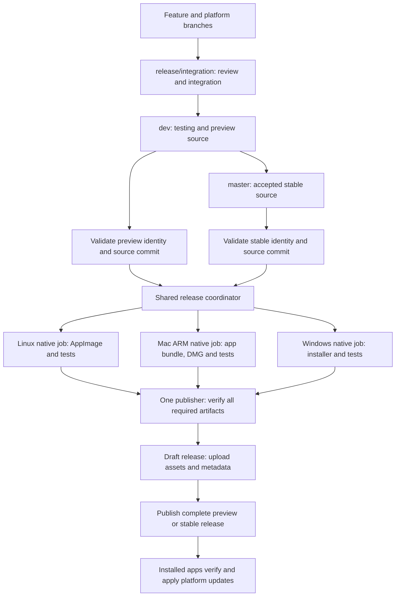

# Multi-platform integration, previews and stable releases

## Status and instructions for the next agent

Created: 2026-10-30. **Implementation started on `release/integration`: Phase 0
complete; shared Mac/Windows source integration and Phase 3 automation in progress.** See the implementation record below and
[integration inventory](MULTIPLATFORM_INTEGRATION_INVENTORY.md).

The owner requested this Markdown handoff only for this session. Do not interpret
its creation as permission to merge branches, push changes, publish another
release, or promote `dev` to `master` now. When the owner asks to begin this plan,
work through the phases below and record actual results here. Do not report a
phase complete merely because scripts or workflow files exist.

Start by reading this file, `AGENTS.md`,
[`RELEASE_PIPELINE.md`](RELEASE_PIPELINE.md), `packaging/README.md`, and the
current platform instructions discovered in Phase 0. Inspect the working tree
before changing anything. Preserve unrelated and unmerged work.

The intended implementation scope, once started, is:

1. Inspect the remote `mac` and `windows` branches and current `dev`.
2. Create `release/integration` from current `dev`.
3. Review and merge the Mac and Windows work there, preserving Linux behaviour.
4. Build and test the integrated application on all three operating systems.
5. Implement coordinated three-platform preview publication from `dev`.
6. Implement stable publication from `master`, with first stable **`v1.0.0`**.
7. Implement and verify installed-app update delivery and preview-to-stable
   transitions for supported platforms.
8. Document evidence, outstanding limitations and operating instructions.

Do not guess Windows implementation details before its branch is available.
Do not develop directly on `dev` or `master`. Final public publication and stable
promotion are explicit rollout steps, not incidental consequences of testing.

## Owner decisions

- One shared application codebase; platform-specific packaging, dependency locks,
  signing and installation mechanisms where necessary.
- `dev` is the integration/testing source and publishes previews.
- `master` is the stable source. The first stable identity is **`v1.0.0`**.
- Release engineering work uses `release/` branches. The requested integration
  branch name is **`release/integration`**.
- The existing public Linux **`v0.1-preview`** remains unchanged.
- Keep the current preview naming convention: subsequent names can be
  `v0.1-preview.1`, `v0.1-preview.2`, etc. Determine the next unused identity at
  implementation time; do not silently switch to a different naming convention.
- Windows changes will be pushed by the owner to **`windows`**.
- Reuse and integrate the existing Mac build work, including DMG creation.
- The wider application roadmap and release checklist remain separate work.
  Preview pipeline success does not certify unfinished features as complete.
  Stable readiness must be assessed explicitly before shipping `v1.0.0`.

## Known starting point — recheck before implementation

At the planning inspection:

| Ref | Observed commit | Meaning |
| --- | --- | --- |
| `dev` | `af5fb18` | Linux preview pipeline/updater and publication records |
| `release/v0.1-testing` | `af5fb18` | Current local working branch |
| `master` | `294c59a` | Untouched by Linux preview implementation |
| Remote `mac` | `86950a8` | Substantial Mac packaging and shared app changes |
| Remote `windows` | Not inspected | Owner will push it; inspect in Phase 0 |

These are historical observations, not commits to hardcode into future jobs.

The Linux release is public at
<https://github.com/Ronit9320/magnite_llm/releases/tag/v0.1-preview>.
Its source commit is `e629bfb`; later documentation was integrated into `dev`.

The canonical identity is `backend/src/backend/_version.py`:

```python
RELEASE_VERSION = "v0.1-preview"
UPDATE_SEQUENCE = 1
DATA_SCHEMA = 1
```

The current parser and updater understand previews only. Stable support is not
implemented. `.github/workflows/linux-preview.yml` builds on `dev` and
`release/**`; it explicitly excludes `master`. Replace or refactor its publishing
path before enabling a new coordinator, so two workflows cannot publish the
same version independently.

The Mac branch includes `.app` and DMG scripts, an isolated Python runtime,
Mach-O/bundle verification, dependency locks, test records, local API
authentication, process lifecycle changes and training fixes. Its scripts target
Apple Silicon and a macOS 14 deployment baseline. This is not evidence of Intel
support or actual testing on every macOS version at or above that baseline.

Important integration issues already observed:

- Mac `build_app.sh` hardcodes `0.1.0-test.1`; CMake also carries separate numeric
  identity fields. Derive every current build identity from the canonical file.
- Both branches modify CMake, backend startup/client communication and runtime
  preparation. A successful Git merge alone cannot establish correctness.
- Mac authentication must cover update coordination and readiness checks without
  breaking the Linux updater or standalone backend usage.
- The Mac docs defer Developer ID signing/notarization. Do not claim otherwise.
- Mac status files contain old phase statements alongside newer results. Reconcile
  them with actual commits and evidence; do not execute stale phase commands blindly.
- The Windows branch may contain additional shared changes and platform-specific
  instructions. Discover them before choosing installer/updater tooling.

## Target architecture



All platform jobs check out the **same exact commit** and consume the same
canonical version, update sequence and data schema. Native jobs may use different
Qt distributions, dependency locks and acceleration backends. Do not flatten
those differences into one cross-platform Python lock.

Use reusable platform build workflows or equivalent separate jobs, coordinated
by one release workflow. Suggested responsibilities, not mandatory filenames:

- `verify.yml`: shared regressions and platform verification.
- `build-linux.yml`: reusable Linux packaging and evidence.
- `build-macos.yml`: reusable Mac packaging and evidence.
- `build-windows.yml`: reusable Windows packaging and evidence.
- `release.yml`: identity validation, required-platform selection, build fan-out,
  artifact collection and one publication job.

Each build uploads its tested package, checksums, build provenance and test
evidence. One publisher validates the whole set. Builders do not independently
create releases. Keep signing secrets away from untrusted pull request jobs.

## Branch, version and publication policy to implement

| Event | Required behaviour |
| --- | --- |
| Feature/platform branch or PR | Verify and optionally package; no public release |
| `release/integration` push | Build/test integrated candidate; no automatic public release |
| `dev` push | Build/test enabled platforms; publish only a new valid preview identity |
| PR into `master` | Verify candidate and stable identity; no public release |
| `master` push | Build/test stable source; publish only a new valid stable identity |
| Manual dispatch | Apply the same source/channel restrictions; no arbitrary-ref stable publication |
| Existing published identity | Never overwrite assets or tags; report that publication was skipped |

This intentionally replaces the current automatic publication from every
`release/**` push. Integration iterations should not accidentally ship publicly.
Version-sensitive release logic must run even when an ordinary packaging path
filter would otherwise skip a change. Documentation-only commits may skip costly
builds when there is no new identity requiring publication.

Rules:

1. Preview format stays `vMAJOR.MINOR[.PATCH]-preview[.N]`, including the existing
   `v0.1-preview` spelling. Stable format is `vMAJOR.MINOR.PATCH`.
2. The first stable release is `v1.0.0`; do not infer an earlier stable release
   from the preview version number.
3. Derive Python PEP 440 metadata, CMake values, UI labels, backend health version,
   filenames, tags, build information and platform numeric version fields from
   the canonical identity. Document the deterministic numeric mapping.
4. Increase `UPDATE_SEQUENCE` for every newly distributed application release,
   including stable promotion. Do not reset it when the channel changes.
5. Validate the proposed sequence against published signed release history, not
   just the candidate source file. Reject ambiguous/reused identity or sequence.
6. `DATA_SCHEMA` describes persisted-format compatibility. Do not change it just
   for platform packaging. Preserve rejection of incompatible schema updates
   until real migration support is implemented and tested.
7. A preview identity on `master` must fail release validation; it must not be
   silently relabelled stable. Stable identities on `dev` cannot publish previews.
8. Tags point to the exact packaged commit. Public releases are immutable by policy.

Stable preparation needs an explicit release change based on tested `dev`, with
the stable identity, increased sequence and final notes reviewed before merging
into `master`. Following promotion, reconcile `dev` with the stable changes and
prepare its next preview identity before further preview publication. Record
the precise merge procedure during implementation so the branches do not diverge
through recurring manual version edits.

## Phase 0 — inventory and integration preparation

Status: **COMPLETE** — 2026-10-30; inventory and Linux baseline recorded in
[MULTIPLATFORM_INTEGRATION_INVENTORY.md](MULTIPLATFORM_INTEGRATION_INVENTORY.md).
The actual pushed Windows branch is `windows-build-fix` (`2350dff`), not `windows`.
Integration started at local dev `f3d8d36`, retaining its planning commit above
remote dev `af5fb18`.

- Inspect status, remotes, current instructions, all relevant branch tips and
  unmerged history. Fetch current `dev`, `mac`, `windows` and `master`.
- If `windows` is absent, record that dependency and continue independent Mac,
  Linux and shared planning work. Do not fabricate Windows build results.
- Read platform docs and scripts, including any nested `AGENTS.md` files.
- Record merge bases, unique commits and shared-file changes for each platform.
- Identify stale identity literals, dependency changes, data-path changes,
  authentication assumptions and process-management differences.
- Run appropriate baseline checks on the existing `dev`; record tool versions,
  environment and failures before integration.
- Create `release/integration` from latest `dev` when ready. If the branch already
  exists, inspect and reuse it safely; do not reset or overwrite its work.

Acceptance: a written inventory, preserved source branches, a clean understood
baseline and an integration branch with an explicit starting commit.

## Phase 1 — integrate Mac while preserving Linux

Status: **IN PROGRESS**. Reviewed Mac source integrated; Linux source and
diagnostic AppImage checks pass. Native Mac checks against the integrated source
remain outstanding, as does hosted Ubuntu/glibc-2.35 verification.

- Merge reviewed Mac changes into `release/integration`. Resolve shared files
  semantically; preserve the canonical identity and working Linux updater.
- Keep bundle discovery and Mac-specific code properly platform guarded.
- Integrate local API authentication across all client requests, raw health
  probes, update quiesce/resume and supported backend launch modes.
- Review data-directory locks, parent supervision, shutdown and training changes.
- Reconcile runtime preparation while preserving separate dependency locks and
  Linux CPU portability settings.
- Preserve the existing Mac `.app`/DMG machinery and testing evidence. Replace
  active hardcoded build identities; retain accurate historical records.
- Re-run Linux backend, native, theme/UI and updater tests plus a packaged Linux
  regression pass. Run Mac native and package checks on a Mac runner/device.

Acceptance: integrated shared code works on Linux and Mac; evidence identifies
exact commits and environments. No claim that Linux testing verifies Mac code.

## Phase 2 — integrate Windows

Status: **IN PROGRESS**. Windows `2350dff` integrated semantically; shared Linux
checks pass. Native Windows and final all-platform same-source builds pending.

- Review the actual pushed branch, its build recipe, installer, runtime layout,
  dependency locks, supported architecture/OS and existing updater work.
- Merge into `release/integration`, preserving both earlier platform paths.
- Review process-tree cleanup, executable/runtime discovery, paths with spaces,
  file locking, permissions, local API authentication and user data locations.
- Reuse existing viable Windows packaging. Choose missing installer/updater
  tooling only after assessing the implementation; document the decision.
- Derive Windows display and numeric versions from the canonical identity.
- Test native compilation, regressions, packaged launch and lifecycle on Windows;
  repeat Linux/Mac checks affected by shared changes.

Acceptance: one commit builds all three platform packages with no unexamined
shared-code conflicts or falsely claimed platform test results.

## Phase 3 — automate reproducible native packages

Status: **IN PROGRESS**. Reusable Linux/Mac/Windows package jobs and artifact-only
integration coordinator implemented; clean hosted runs and their evidence are
required before completion. See [native build operations](NATIVE_PACKAGES.md).

- Build Linux on the existing supported glibc baseline; retain portable CPU
  settings, pinned AppImage tools and ELF compatibility audit.
- Build Mac on an explicitly selected Apple Silicon runner; install the required
  pinned Qt/tooling and execute the existing bundle/DMG pipeline. Remove local
  machine path assumptions and document the deployment baseline.
- Build Windows on an explicitly selected matching runner/toolchain; stage Qt,
  required non-Qt libraries, isolated Python and the platform dependency set.
- Reproduce from a clean checkout. Fail public release builds with dirty source
  provenance or host-Python/host-library leakage.
- Upload uniquely named platform artifacts and evidence, including version,
  sequence, schema, source commit, architecture and resolved runtime packages.
- Measure runner disk/time needs. Cache dependencies safely without reusing an
  unverified staged application from another commit.
- Separate GUI/startup tests from GPU acceptance tests where hosted runners do
  not supply usable Metal/MPS or other required hardware. Record those gaps and
  require actual device evidence for the relevant capability claims.

Acceptance: clean hosted runs produce all three packages from one commit,
with reproducible commands and accessible evidence. Local-only successful builds
do not satisfy hosted automation acceptance.

## Phase 4 — canonical stable identity and update channels

Status: **NOT STARTED**.

- Extend canonical identity parsing and derived metadata for stable `v1.0.0`
  while keeping existing preview spelling compatible.
- Extend signed metadata validation and ordering to previews and stable releases.
  Preserve current Linux signature trust and existing public key.
- Stable installations receive stable updates by default. Preview installations
  can advance to newer previews and to stable. Preview opt-in from stable is an
  explicit setting; define its ordering and downgrade rules.
- Define channel ordering using release validity plus the monotonic sequence;
  do not use lexicographic version sorting or reset anti-rollback state.
- Verify old metadata compatibility. Publish a bridge preview that understands
  stable releases before relying on existing Linux `v0.1-preview` users to move
  automatically to stable.
- Document platform feed formats and the shared compatibility/security policy.

Acceptance: meaningful tests cover old-preview discovery, the bridge update,
preview-to-stable, stable-to-stable, opt-in behaviour, invalid identity/channel,
reused sequence, schema mismatch, tampering and wrong-platform rejection.

## Phase 5 — Mac and Windows installed-app updates and signing

Status: **NOT STARTED**. Depends on the integrated platform implementations.

- Inventory any updater work already present before adding another framework.
  Evaluate Sparkle for Mac and WinSparkle/native installer integration for Windows
  if the branches do not already provide a suitable solution. Record the choice.
- Keep a shared idle/quiesce policy: do not interrupt model downloads, training,
  active requests or other protected work. Stop the backend gracefully before
  replacement and preserve user data outside the installation.
- Implement platform-specific download verification, installation, relaunch,
  cancellation, error reporting and documented recovery. Do not promise the Linux
  helper's atomic exchange/rollback semantics on another OS without implementing
  and verifying equivalent behaviour.
- Mac: distinguish DMG first installation from updater delivery; prepare the
  archive/feed required by the chosen updater. Keep ad-hoc tester builds clearly
  identified. Add Developer ID signing/notarization support for distributable
  stable packages; defer actual credentials to owner setup when required.
- Windows: distinguish update metadata signatures from Authenticode signatures;
  implement the selected signing path and installer invocation. Verify process
  cleanup and locked-file behaviour with the actual installer.
- Document required secrets/certificates, safe injection and key backup/rotation.
  Never commit keys or replace the existing Linux public key casually.
- If a static appcast/feed is required, choose and document its hosting and
  publication order. Publish feed references only after package assets exist.

Acceptance: successful and failed update transactions tested on each native OS,
including busy/cancel cases, authenticity failure, restart and data preservation.
Missing signing credentials or native evidence remain explicit blockers for
the affected release claims, not silently skipped successful checks.

## Phase 6 — one coordinated preview/stable publisher

Status: **NOT STARTED**. Depends on Phases 3–5 for supported release capabilities.

- Implement the branch/channel table and source guards above.
- Retire the old independent Linux publishing path while retaining its tests.
- Fan out native jobs using one validated identity and exact source SHA.
- Configure the required platform set explicitly. The requested combined preview
  requires Linux, Mac and Windows; a missing/failed platform blocks publication.
- Collect the exact tested packages; reject missing, duplicate or mismatched
  artifacts. Aggregate checksums without platforms overwriting each other's files.
- Keep release-write permission and signing credentials confined to trusted jobs.
  OS code signing may require a dedicated trusted native job before final package
  verification; tests must cover the final distributed signed bytes.
- Serialize publication per version; prevent competing runs from racing.
- Inspect existing releases/tags before creating anything. Distinguish a genuine
  missing release from authentication, API or network failure. Refuse ambiguous
  existing drafts/tags and document recovery; never delete them automatically.
- Create a draft at the exact source SHA, upload all required assets and signed
  update metadata, validate contents, then make it public.
- `dev`: prerelease, not latest stable. `master`: stable, latest when appropriate.
- Validate manual runs with the same rules; unrelated refs cannot publish stable.
- Make failure evidence available even when packaging or publication fails.

Acceptance: exercise artifact-only/draft testing and failure paths first. Verify
all-platform success gating, wrong-branch/channel rejection, immutable existing
versions, concurrency and interrupted-draft recovery before live rollout.

## Phase 7 — complete acceptance testing

Status: **NOT STARTED**.

Run checks appropriate to each platform using its packaged runtime. Record pass,
failure, unsupported or not run accurately; do not replace device checks with
assumptions based on a sibling operating system.

| Area | Required coverage |
| --- | --- |
| Shared backend | Offline regressions, authenticated API, locks, parent lifecycle and update gate |
| Native client | CMake compilation, theme audit, UI checks, startup/backend readiness |
| Relocation | Package outside checkout, poisoned Python environment, no development runtime dependency |
| Features | Pull, load/chat/unload, training, adapter switching, RAG, storage operations with tiny fixtures |
| Linux | AppImage launch, glibc audit, updater signatures, installation, startup rollback and lock handling |
| Mac | Bundle/Mach-O audit, DMG mount/copy/launch, signatures, installed lifecycle, Metal/MPS device evidence |
| Windows | Installer install/upgrade/uninstall, paths with spaces, locked files, process cleanup and installed launch |
| Updates | Older installed package to new preview; bridge preview to stable candidate; invalid/cancel/busy/failure paths |
| User data | Models, datasets, adapters, preferences and persisted data preserved during upgrade/recovery |
| Publication | One source SHA, complete asset set, valid signatures/checksums, correct channel/tag/latest status |

Use isolated test data and disposable installation locations. Do not erase real
user data to simulate a clean installation. Establish recovery tests against the
actual selected platform installer/update mechanism.

Acceptance: all required checks pass, or an explicit platform limitation is
accepted and documented before publication. A three-platform release cannot be
labelled verified if one platform was never built or tested.

## Phase 8 — integrated preview rollout

Status: **NOT STARTED**. Public publication is a distinct rollout step.

- Choose the next unused current-style preview identity and sequence; do not
  overwrite or add replacement binaries under `v0.1-preview`.
- Complete release notes and accurate platform/testing/signing disclosures.
- Review the integration diff and merge the accepted work into `dev` when the
  owner starts the rollout. Account for the fact that pushing a new valid preview
  identity to `dev` will trigger publication under the implemented policy.
- Verify the actual hosted builds, published assets, signatures and downloads.
- Exercise updates from the live first Linux preview through any required bridge
  preview. Verify Mac and Windows installation/update paths with native devices.
- Record run URLs, release URL, source SHA, checksums and native test evidence.
- Preserve unmerged platform work. Delete completed branches only after checking
  that their commits are merged into `dev` and cleanup is appropriate.

Acceptance: a live, verified three-platform preview and usable operating guide.
Stable publication is not implied by preview acceptance.

## Phase 9 — stable readiness and v1.0.0 rollout

Status: **NOT STARTED**. Implement infrastructure earlier; ship only when ready.

- Assess the real release checklist and application readiness. Do not mark
  unfinished roadmap/security/licensing/feature items complete because CI passed.
- Resolve stable distribution prerequisites, including platform signing and
  notarization policy, supported OS/architecture claims and native acceptance.
- Prepare a reviewed stable release change with `RELEASE_VERSION = "v1.0.0"`, a
  new increasing sequence, deliberate schema value and final release notes.
- Verify stable candidate packages from the exact proposed source and test
  preview-to-stable and stable updater behaviour using disposable candidates.
  Never publish a fake stable release merely to test the workflow.
- Promote the accepted candidate to `master` only as an explicit release action.
  Its push triggers the new stable pipeline; builds must all pass before publish.
- Verify public release assets, tag/source SHA, stable/latest flags, platform feeds
  and installed updates. Record release evidence and recovery instructions.
- Reconcile `dev` after promotion and prepare the next preview development cycle.

Acceptance: verified `v1.0.0` from `master`, with stable delivery working on all
declared platforms. Infrastructure can be complete while this rollout remains
pending application readiness or an owner release decision.

## Evidence and handoff protocol

Update each phase status to NOT STARTED, IN PROGRESS, BLOCKED or COMPLETE. For
every implementation session, append a record below containing:

- Date, branch, starting/ending commit and working-tree state.
- Files/behaviour changed and reasons for significant decisions.
- Commands, runner/device OS and architecture, tool/dependency versions.
- Tests run, results and links/paths to logs or artifacts.
- Failures, known limitations and unresolved decisions or credentials.
- Exact next phase/task and prerequisites, so the next agent can resume safely.

Do not put secrets into logs or this document. Do not claim a test ran merely
because another branch or a historical status file says it passed. Update the
main release pipeline guide and platform operating instructions as implemented
behaviour changes; this plan must not become the sole source of user instructions.

### Planning record — 2026-10-30

- Created this plan only, as requested by the owner.
- No integration branch, merge, application/workflow change, test run, commit,
  push, new release or `master` promotion performed for this planning task.
- Windows implementation has not been inspected. First implementation task:
  Phase 0, including checking the owner's newly pushed `windows` branch.

### Implementation record — 2026-10-30: inventory and Mac integration

- Started on clean local `dev` at `f3d8d36`; fetched current remote tips and
  created `release/integration` from that commit. Windows was pushed as
  `windows-build-fix`, tip `2350dff`. Full inputs, merge bases, shared-file review,
  tool versions and baseline results are in the
  [inventory](MULTIPLATFORM_INTEGRATION_INVENTORY.md).
- Phase 0 COMPLETE. Reviewed and integrated Mac `86950a8`, with semantic
  resolutions preserving Linux updater behavior and dependency pins. No Windows
  merge yet: Phase 2 depends on Phase 1 native acceptance. All source branches
  remain preserved. No push, public publication, stable promotion, release
  identity change, schema bump or signing-key change.
- Ending application/source merge: `ad1489e57fd3308100d530b011c98995d960bd2c`,
  with parents `f3d8d36` and `86950a8`. Verified that `origin/mac` is an ancestor
  and the tree was clean after that commit. A documentation-only follow-up
  records this finalized source SHA; no application code changed after the
  diagnostic package tests. The Windows branch remains unmerged and preserved.
- Integrated per-launch API authentication, POSIX data-folder locking, Mac
  parent supervision, training capability handling, guarded bundle runtime
  lookup, `.app`/DMG tooling and historical evidence. Raw health transport retains
  canonical backend-version matching for update startup/rollback. Removed the
  active Mac version override, derived numeric bundle fields, retained Linux
  CPU locks, and required platform runtime locks. Added an authenticated update
  quiesce/resume regression. Reconciled stale Mac status instructions and active
  package examples; old test records retain their original identities.
- Linux source checks: CMake configure/build PASS; CTest manifest PASS (1/1);
  theme and UI audits PASS (0 failures); desktop/backend selftest PASS (0
  failures); backend suite **71 tests run, 70 passed, 1 skipped** (the real Mac
  parent-death test); updater helper transactions PASS (6/6). Shell syntax checks
  for changed Mac build scripts and runtime CLI help PASS. Workflow YAML parses
  and its publisher guard is `github.ref == 'refs/heads/dev'`; hosted execution
  has not run. The staged whitespace audit passes with `blank-at-eof` disabled:
  five imported Mac historical/license files already contain trailing blank
  lines, which were preserved rather than rewriting third-party license texts.
- Evidence is local under `build/packaging/multiplatform/mac-{build,configure,
  ctest,theme,ui,selftest,backend,helper}.log`. Backend/UI/desktop tests used
  authorized loopback access after sandbox-only socket failures. The stalled
  initial sandbox baseline was interrupted; it is not counted as a passing run.
- Diagnostic Linux AppImage rebuilt with
  `MAGNITE_GLIBC_MAX=2.43 bash packaging/build_appimage.sh`. Initial sandbox
  build failed on PyPI DNS resolution; authorized network retry PASS. Existing
  `dist/` artifacts were preserved before rebuilding and restored afterwards.
  The new candidate and checksums are isolated under
  `build/packaging/multiplatform/mac-linux-diagnostic/`. Audit: **616 ELF files,
  maximum glibc 2.43, zero offenders** for this diagnostic baseline. This does
  not satisfy the hosted Ubuntu 2.35 claim.
- Diagnostic AppImage SHA-256:
  `df90fc94c7db3f29cadce233c538130b1d8781fe225f55d2dc592e7c1d425378`.
  Built from the integration working tree before the merge commit; embedded
  provenance accurately records `f3d8d36` and `working_tree_modified: true`.
  It is a local test artifact, not a new distributed release or a replacement
  for the public preview.
- `python3 packaging/smoke_appimage.py <candidate> --logs
  build/packaging/multiplatform/mac-relocated --cache build/packaging/test-cache
  --features`: all **7 checks PASS** — extraction, theme, UI, authenticated
  desktop startup, real GGUF inference, combined real CPU LoRA/adapter/RAG
  workflow, and the actual AppImage extract-and-run launcher. Runs relocate
  outside the checkout with poisoned host Python paths. Main result log:
  `build/packaging/multiplatform/mac-package-tests.log`; builder log:
  `build/packaging/multiplatform/mac-appimage-build.log`.
- Phase 1 remains IN PROGRESS: this environment is Linux x86_64, with no native
  Mac/Windows runner or device execution available in this session. Historical
  Mac evidence cannot close this gap. Signing/notarization remains deferred;
  no new signing credentials were requested or installed. As an early prerequisite
  for hosted integration testing, the existing Linux publisher is now guarded to
  `refs/heads/dev` only. Release branches build/test artifacts without publishing,
  including manual runs. The coordinator is not implemented; Phase 6 is not complete.
- Next: on a native Apple Silicon Mac, build this integrated source using
  `MAGNITE_QT_ROOT=<pinned Qt 6.8.3>/macos bash packaging/macos/build_app.sh`, run
  bundle/DMG audits, relocated smoke, installed acceptance, authenticated update
  gate and lifecycle checks, and record exact source/environment/results. Run
  hosted Linux Ubuntu 22.04 checks using the guarded artifact-only integration path.
  Once Phase 1 acceptance is met, merge the reviewed `windows-build-fix` branch
  semantically in Phase 2; its existing scripts are source-build support, with
  installer/runtime locks/updater/signing still missing. Later automation,
  channels, publication and stable rollout phases remain NOT STARTED.

### Implementation record — 2026-10-30: Windows integration and native automation

- Owner requested completion through Phase 3. Continued from clean
  `release/integration` at `c2f7406`. Refreshed source branches; integrated
  `windows-build-fix` at `2350dff` without resetting any branch. Preserved Mac
  parent supervision while resolving the backend/main.py merge conflict.
- Reconciled source discovery for build/Release with package-first runtime
  selection. Windows `.venv312` probes are confined to source builds on Windows;
  Linux `.venv` precedence remains unchanged. Added Windows process-tree Job
  supervision, authenticated graceful server shutdown, byte-range data locks,
  canonical native version resources, and failing-command checks in source
  build scripts. Added authenticated shutdown/lifetime regressions.
- Implemented a per-user, unsigned Inno Setup Windows CPU testing installer,
  isolated Python runtime, Windows-specific direct/transitive dependency locks,
  explicit Qt/OpenSSL/MSVC deployment, version mapping and installed smoke
  harness. Native installer reinstallation is not evidence of full cross-version
  updater/locked-file recovery, which remains Phase 5 work.
- Added reusable native builders and a read-only artifact-only integration
  coordinator. Every builder checks out the same source SHA, requires clean
  provenance and emits independent checksums/package evidence; final acceptance
  rejects missing platforms, mismatched source/identity and changed package
  bytes. Linux retains Ubuntu 22.04/glibc-2.35 audit and all earlier tests. Mac
  uses ARM macOS 15, pinned Qt and a checksum-verified static OpenSSL build with
  a macOS 14 deployment target. Windows uses Windows Server 2022/MSVC 2022 and
  pinned Qt/vcpkg/Inno tooling. No staged app is restored from cache.
- Local Linux evidence under `build/packaging/multiplatform/phase3/`: configure/
  build PASS; 72 backend tests run, 71 passed, one native Mac test skipped;
  nine packaging tests PASS (six actual updater transactions and three native
  artifact-set regressions); CTest PASS; theme/UI/desktop selftest PASS. Python
  compile checks, shell syntax checks, and actionlint 1.7.7 PASS before the
  first hosted candidate. The linter was downloaded to /tmp after sandbox DNS
  restrictions; source dependency locks were resolved with authorized network
  access. Windows scripts still require native execution for acceptance.
- Native build operations: [NATIVE_PACKAGES.md](NATIVE_PACKAGES.md). Windows
  decisions/commands: [packaging guide](../../packaging/windows/README.md).
  Signing, updater delivery, channels and publication (Phases 4+) are outside
  this request; public release identity and existing published assets unchanged.
- Native hosted runs are the next acceptance step; phases remain IN PROGRESS
  until those results are recorded. No GitHub API token/CLI login is available;
  owner selected public job status only. Artifact-only integration push is
  necessary to execute the requested hosted validation. No merge/push to dev
  or master is involved.
- Native run [41060457131](https://github.com/Ronit9320/magnite_llm/actions/runs/41060457131)
  at `5f07de6`: Linux reusable package job PASS, including its Ubuntu/glibc
  audit and relocated tests. Mac and Windows did not pass, so aggregate
  acceptance was skipped. The public-only debugging choice was respected;
  artifact download returned 401, and bounded failure excerpts were added as
  public job annotations instead of requesting credentials again.
- Initial `29e919d` jobs failed native setup-python 3.12.12 availability. Host
  tooling now uses pinned 3.12.10 on Mac/Windows; isolated shipped runtime stays
  3.12.12. Native coordinator cancels superseded artifact-only candidates, and
  legacy Linux packaging skips integration pushes to avoid duplicate builds.
- The `5f07de6` Mac bundle passed layout, all 368 ARM Mach-O architecture and
  minimum-OS checks, linkage/resolution, symlinks and signature. Its raw-home
  scan falsely matched upstream wheel diagnostic/SBOM paths using the same
  `/Users/runner` account. Refinement permits that generic prefix only in
  third-party binary/archive or dist-info data on GitHub's runner; exact source
  and Qt paths, scripts, actual dylib references and rpaths remain checked.
  A regression verifies that upstream diagnostics do not hide real source paths.
- The `5f07de6` Windows installer compiled successfully. Native regressions
  exposed SQLite handles left open by transaction context managers and archive
  path normalization. SQLite transactions now close deterministically (without
  changing data formats); tests verify commit, rollback and removal with live
  connection references. Archive validation now checks raw `orig_filename`,
  including backslash/NUL names, using wire-byte fixtures that work on Windows.
  Native Windows temporary directories are pinned to RUNNER_TEMP to avoid 8.3
  alias spelling in path-sensitive fixtures.
- After those fixes, local backend suite: 73 run, 72 passed, one Mac-only skip.
  Packaging suite: 10 tests PASS. New native candidates are required before
  Phases 1–3 can be marked complete. No public release was created or modified.
- Native run [41064678856](https://github.com/Ronit9320/magnite_llm/actions/runs/41064678856)
  at `8faaae9`: Linux package PASS again; Mac bundle audit PASS and all 73
  native backend tests PASS, including actual parent-death coverage. Relocated
  theme/desktop checks passed, but bundle signatures were invalidated during
  the regression stage before relocation. Regression child interpreters now
  inherit bytecode suppression; a signature check immediately after regressions
  and verbose signature diagnostics enforce bundle immutability. Added Mac
  native CTest execution for the shared signed manifest implementation.
- In that same run, Windows native compilation and installer creation passed;
  SQLite and archive tests were fixed. The remaining native suite failure was
  a BOM fixture using platform-default encoding (CP1252). The fixture now
  explicitly writes UTF-8. No application encoding policy was changed to hide
  the test failure. Windows installation/lifecycle acceptance still needs its
  first successful run; aggregate acceptance remains pending.
- Native run [41067786933](https://github.com/Ronit9320/magnite_llm/actions/runs/41067786933)
  at `f60148a`: Linux package PASS. The newly enabled Mac CTest verified valid
  signatures, tampering, untrusted keys and malformed fields, but exposed a
  Linux-only test expectation: rejecting a numeric future glibc requirement on
  macOS. That host-compatibility assertion is now Linux-guarded; malformed glibc
  metadata remains tested everywhere, and production verification is unchanged.
  Local Linux CTest still passes with the Linux assertion enabled. A fresh
  native run is required to reach later Mac/Windows package checks.
- Native run [41069672641](https://github.com/Ronit9320/magnite_llm/actions/runs/41069672641)
  at `f400dea`: Linux package PASS; Windows all native job steps PASS, including
  backend/manifest tests and actual per-user install, startup/UI, same-candidate
  upgrade, crash cleanup/restart, uninstall and external-data preservation.
  Mac audit, 73 backend tests, manifest CTest and the post-regression signature
  check passed. The relocated smoke still invalidated its seal during startup.
- Root cause: the native smoke call supplied a relative log/data directory.
  The backend's executable-directory cwd put relative MAGNITE_HOME databases
  inside the relocated bundle. The harness now canonicalizes log paths, and
  the client resolves relative data overrides against the desktop launch cwd
  before starting the backend. Local desktop selftest from /tmp with
  MAGNITE_HOME=data passed and created all five database files under that launch
  directory, outside the executable directory. Added before/after bundle byte,
  link, mode and diagnostic attribute inventories; OS provenance attributes
  are recorded while signature verification remains the seal gate.
  This is not a re-sign-after-tests workaround: original tested bundle bytes
  must remain unchanged. Native Mac acceptance and the one-SHA combined run
  remain pending the corrected candidate.
- Native run [41072682626](https://github.com/Ronit9320/magnite_llm/actions/runs/41072682626)
  at `6e8e049`: **all three native package jobs PASS from that exact commit**.
  Mac relocated content/seal checks, CPU feature workflow, DMG creation and
  read-only mount smoke all passed. Windows complete installed lifecycle and
  Linux full package checks passed again. Final aggregate verification failed;
  it was using the runner's default Python despite depending on Python 3.11+
  hashing. The aggregate job now pins Python 3.12.12 and emits public diagnostic
  errors. Phase 3 remains open until the complete-set gate passes.
- Final helper review found the second-account Mac kit's old hardcoded DMG
  identity and its newly introduced snapshot-helper dependency. The kit now
  derives identity canonically, copies the helper alongside the smoke script,
  resolves its own location, and renders current version/custom-kit paths into
  the copied guide. The snapshot helper supports system Python 3.9 syntax and
  streaming hashing, checked with a local content-mutation fixture. Historical
  original tester records remain unchanged.
- Native run [41077134268](https://github.com/Ronit9320/magnite_llm/actions/runs/41077134268)
  at `d88e110`: Linux package PASS; Mac intermittently failed the existing
  training queue/history regression before packaging. Investigation identified
  concurrent shutdown/worker SQLite writes: an older serialized "running"
  snapshot could commit after the worker's "done" snapshot. A dedicated lock
  now serializes snapshot creation and commit. A targeted threaded regression
  reproduces the overwrite when serialization is disabled (negative control)
  and passes with the lock. The queue/history assertion was retained.
- Local backend suite after that fix: 74 tests, 73 passed, one Mac-only skip;
  source/build state remains on release/integration. Native revalidation is
  required; no phase is being declared complete based on a flaky/skipped gate.
