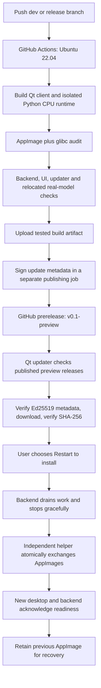

# Linux preview releases and application updates

## Scope and decisions

The first application release is **v0.1-preview**. Linux x86-64 with the bundled
CPU runtime is the initial package. Windows and macOS packaging/updaters follow
later. This is an unfinished development preview intended to exercise release
and update delivery while the original application's roadmap continues.

Work is on the existing `release/v0.1-testing` branch. That branch contained the
original AppImage work and was fast-forwarded to `dev` at `c00d93a` before this
implementation. All original packaging commits were already ancestors of `dev`.
The other local branches were inspected; the remote `mac` branch contains only
a health-probe change. `master` is not a release source for this preview and is
left untouched. Feature branches remain reserved for normal feature work.

The owner explicitly deferred the broader release checklist until later. Its
unchecked work remains open; passing this pipeline does not certify those
features, security repairs, licensing reviews, or platform support as complete.

## Architecture



GitHub Actions builds and tests packages. GitHub Releases hosts packages and
signed metadata. Installed clients independently check for updates. Publishing
an update does not instantly replace copies on offline user computers.

No hosted inference server or custom update API is introduced. App update traffic
uses GitHub over HTTPS. Existing ML execution stays in the local Python backend.

## One application version

`backend/src/backend/_version.py` is the canonical source:

- `RELEASE_VERSION`: `v0.1-preview`, used for UI, health/API metadata, tags,
  filenames, release metadata, and build information.
- `UPDATE_SEQUENCE`: `1`, the monotonic update ordering value.
- `DATA_SCHEMA`: `1`, the current data compatibility generation.

Python distribution metadata requires PEP 440. Its `0.1rc0` spelling is computed
from the release identity and is not another editable application version.
CMake reads this same file. Packaging does not accept an independent display
version override. Historical evidence describes older builds; those binaries
must not be relabeled as this release. Future roadmap milestone labels are not
installed application version identities.

For every subsequent distributed update, change the canonical preview version
and increase `UPDATE_SEQUENCE`. Never overwrite an already published version.
The updater checks the signed sequence against both its compiled sequence and
the highest successfully started sequence stored in QSettings.

## Workflow and branch behavior

`.github/workflows/linux-preview.yml` runs on pushes to `dev` and `release/**`.
Documentation-only pushes skip the expensive package workflow. Manual dispatch
is also guarded to those branches. There is no master/tag push
trigger, master merge, or production promotion step.

1. Build on Ubuntu 22.04, targeting glibc 2.35 or older requirements.
2. Bundle Python 3.12.12 and the CPU dependencies; build portable CPU llama.cpp.
3. Verify AppImage tool SHA-256 values from `packaging/tools.lock.json`.
4. Audit every staged ELF file; reject symbols newer than the baseline.
5. Run signature/manifest tests, real installer transaction tests, backend
   regressions, theme/UI/startup tests, and relocated tiny-model workflows.
6. Upload the exact tested AppImage and verification evidence as Actions artifacts.
7. Download that artifact in a separate job with release-write permission.
8. Sign metadata, checking that the private key matches the shipped public key.
9. Create a draft tagged at the workflow commit, upload all assets, then publish
   it as a prerelease with `latest=false`.

An existing published version is never overwritten. Later pushes with an unchanged
version still build/test and upload an Actions artifact, but skip publication;
the workflow summary explains that a version/sequence bump is required. An
unfinished draft requires inspection before retrying. This prevents a user from
seeing a different binary under a version they already installed.

A push to the working release branch can publish the first preview without
merging into `dev`. Subsequent reviewed work can follow the normal merge into
`dev`; a new canonical version then publishes a new preview. Neither requires
changing `master`. Publishing the preview is authorized by the owner despite
the deferred general release checklist.

The release assets are:

```text
Magnite-v0.1-preview-linux-x86_64.AppImage
SHA256SUMS
update-linux-x86_64.json
update-linux-x86_64.json.sig
linux-compatibility.json
TESTING.md
```

The workflow needs GitHub Actions enabled and a repository configuration that
allows its publishing job `contents: write`. Hosted success still needs to be
observed; adding workflow YAML alone is not a passing hosted run.

## Signing setup and repository access

The initial Ed25519 public key is tracked in `packaging/keys/update-public.pem`.
The matching private key was generated locally at:

```text
.release-secrets/update-signing.pem
```

The directory is mode 0700 and the key is mode 0600. `.gitignore` excludes the
whole directory. Never attach the private key to a release, an issue, a build
artifact, or a commit. Keep an independent secure backup; losing it prevents
future releases from being trusted by these installed clients. Key rotation
needs a separately designed trust transition.

Before publishing, add the complete PEM file contents as the repository Actions
secret **MAGNITE_UPDATE_SIGNING_KEY** under Settings → Secrets and variables →
Actions. With an authenticated GitHub CLI, this can be done without displaying
its contents:

```sh
gh secret set MAGNITE_UPDATE_SIGNING_KEY < .release-secrets/update-signing.pem
```

The implementation environment currently has SSH access to the repository but
no GitHub API credential or installed `gh` CLI. Configuring this secret therefore
requires owner setup or an authenticated API session. The workflow reports a
clear error if signing is unconfigured; it does not publish unsigned updates.
Package-build artifacts remain available if building succeeded before that error.

The app contains no GitHub token. Public installed-app updates require public
release access. If the source repository remains private, use a public
release-distribution repository and configure `MAGNITE_RELEASE_REPOSITORY` at
build time. Publishing into a separate repository additionally requires a
credential with access to that repository; the current workflow publishes to
its own repository using its built-in token. Private testers can download from
GitHub after logging in, but this unauthenticated updater cannot read private
release assets.

Enable immutable releases in GitHub if desired; all assets are uploaded while
the release is still a draft. Do not enable settings that prevent the publishing
job from creating its intended preview tag without adapting the workflow.

## Installed-app behavior

Settings → Updates shows the installed version, preview channel, check/download/
cancel/restart controls, and an automatic startup-check preference. Startup checks
run asynchronously after five seconds. Verification/selftest/screenshot modes
make no update check. Checking can fail offline without blocking local work.

The updater lists up to 100 releases, including prereleases, orders eligible
preview tags by version, and skips releases without Linux update assets. It does
not use GitHub's `/latest` endpoint, which excludes prereleases. It reads the
newest eligible Linux preview's
metadata and detached Ed25519 signature. It validates the signature before
trusting version, sequence, hash, size, download path, platform, CPU variant,
minimum glibc, or data compatibility. Download URLs must belong to the configured
repository and match the expected asset filename. HTTPS certificate checks stay
active, and redirects cannot downgrade to HTTP.

Downloads stream to an atomic save file in a private transaction directory beside
the installed image. The updater checks available disk space, a signed size bound,
the complete SHA-256, and the type-2 AppImage header. Cancellation or a failed
verification leaves the installed file unchanged. Downloads are complete bundles;
zsync/delta updates can be added after this first path is proven.

Installation is offered only for a writable Linux x86-64 AppImage. Source builds
can check releases but are rebuilt from source; extracted AppDirs and symlinked
or read-only images do not self-install. Put a portable AppImage in a permanent,
user-writable location before using automatic installation.

Restart is always explicit. The UI warns that current chat is not durable and
asks the user to finish/export work. The desktop disables interactions and asks
`POST /updates/quiesce` to close admission to new work. The ASGI gate rejects
quiescing while another HTTP operation, streamed response, background training
job, or model pull is active. If idle, it rejects new operations until shutdown.
`POST /updates/resume` cancels the maintenance state when necessary. This is
coordination, not a replacement for the separately deferred local IPC security.

The backend is terminated gracefully with a 15-second wait. The update path does
not force-kill it. If shutdown has not completed, installation is postponed.

The independent Linux helper is copied outside the mounted AppImage before exit.
It has no Qt/mounted-image dependency. A lock beside the installed AppImage
serializes application instances and installation. The helper waits for the old
application process and lock, then performs `renameat2(RENAME_EXCHANGE)` on the
same filesystem. This atomically exchanges complete files and retains old bytes.
It launches the new image and waits up to 120 seconds for the Qt app's backend-
readiness acknowledgement. A failed startup is stopped before restoring and
relaunching the previous image. The old image remains in the private transaction
directory after success, alongside status and installer logs. QSettings records
that directory as `updates/lastTransaction`.

A crash or power failure can leave a transaction directory requiring inspection.
The atomic exchange preserves both complete bundles; the helper does not promise
automatic recovery after a system reboot. A native desktop launch remains part
of acceptance testing, beyond the offscreen checks.

## User data and rollback limits

Updates replace the Qt client, bundled Python, backend and runtime together.
They do not reinstall Python packages into a developer venv or modify weights,
datasets, adapters, Qt preferences, or the Magnite store during installation.
Keep a writable AppImage separate from `MAGNITE_HOME` and model caches.

Existing stores have no versioned migration framework. The current updater
therefore requires an exact `DATA_SCHEMA` match. A release that needs a schema
change is rejected with migration instructions rather than installed silently.
The schema field is a release compatibility contract, not an implemented database
migration system. Maintainers must bump it when changing persistent formats.
A previous executable alone cannot reverse a database migration. Future migration
work must cover backups, interrupted migration, restored stores and downgrade
policy before loosening this restriction.

The first preview cannot demonstrate receiving a newer published version until
a subsequent version is published. Local tests exercise signed metadata and real
atomic helper installation/rollback with disposable launcher fixtures instead.

## Windows and macOS follow-up

Keep common versioning, GitHub distribution, release channels and Qt update UI.
Add native runners, platform artifacts, signing, clean-machine tests and dedicated
installation implementations. macOS can evaluate Sparkle with signing/notarization;
Windows needs a signed installer and process-tree-safe replacement. A `.dmg` or
`.exe` download alone does not implement automatic updates. Linux-only helper
code is excluded on other platforms.

Later options include AppImageUpdate/zsync deltas, distribution repositories for
`.deb`/`.rpm`, Flatpak-managed updates, staged rollout, componentized ML runtimes,
key rotation, better recovery UI and stable releases. These are follow-up work.

## Implementation and verification log

- Inspected local/remote branches and existing architecture, release and packaging
  documentation; reused and advanced the original AppImage release branch.
- Centralized app, backend, CMake and package identities; added runtime constraints,
  verified deployment-tool hashes and a glibc compatibility audit.
- Added the preview-only Actions workflow and signed update metadata generation.
- Added Settings update controls, background checking, verified bounded downloads,
  maintenance admission, standalone atomic installation and startup rollback.
- Generated the initial local signing key; only its public key is tracked.
- CMake Release build: passed during implementation.
- Manifest/signature compatibility tests: passed during implementation.
- Theme audit: 0 failures. UI interaction/layout check: 0 failures, with loopback
  access outside the socket-restricted sandbox.
- Backend regressions, helper transaction checks, final package verification,
  GitHub secret setup and first hosted release: results recorded below as completed.

Verification follow-up:

- All 58 backend regressions passed with local socket access. Sandboxed TestClient
  startup stalled; the passing run was outside that socket restriction.
- Six actual helper transaction tests passed: successful exchange/old-image
  retention, failed-startup rollback/relaunch, application-lock waiting, explicit
  cancellation, symlink rejection and unsafe staging permissions.
- A local AppImage rebuild uses an explicit newer-host diagnostic baseline;
  the Ubuntu/glibc-2.35 claim requires the hosted job, not this Arch build.


- The local AppImage was rebuilt successfully; the compatibility audit checked
  616 ELF files and found a highest glibc requirement of 2.43. Deployment tools
  and the embedded AppImage runtime are all verified against locked SHA-256 values.
- Superseded local AppImage/evidence were moved from `dist/` into
  `build/packaging/historical-pre-preview/`; historical binaries were not relabeled.
- Owner selected making the source repository public for unauthenticated updates.
  The signing secret is being configured by the owner.

- Relocation testing caught stale Qt from the old AppDir. Native staging now
  resets before every build while preserving only the Python runtime cache;
  AppRun and native libraries are regenerated together.
- Removed the legacy CMake cached display-label override; canonical release
  identity remains the only editable application version.
- GitHub unauthenticated repository access was confirmed (HTTP 200).

- Added an explicit shell AppRun that executes the real `usr/bin/magnite-app`
  path, so Qt/runtime lookup does not depend on resolving a root-level launcher
  symlink through `/proc/self/exe`. Smoke tests force Qt diagnostics to stderr.

- All seven relocated package checks passed: extraction, theme, UI, desktop/IPC,
  real GGUF inference, combined CPU LoRA/adapter/RAG and the actual AppImage
  extract-and-run launcher. Logs are under `build/packaging/preview-verification/`.
- Signed local release metadata successfully and verified it against the tracked
  public key. This diagnostic Arch package is not the hosted Ubuntu artifact.
- Preserve extract-and-run mode when restarting an update, so a FUSE-free launch
  does not accidentally restart through a FUSE-only path.

## References
- GitHub Releases API: https://docs.github.com/en/rest/releases/releases
- Immutable releases: https://docs.github.com/en/code-security/concepts/supply-chain-security/immutable-releases
- AppImage updates: https://docs.appimage.org/packaging-guide/optional/updates.html
- Qt Installer Framework: https://doc.qt.io/qtinstallerframework/ifw-updates.html
- Sparkle: https://sparkle-project.org/
- VS Code's Linux distribution: https://code.visualstudio.com/docs/setup/linux
